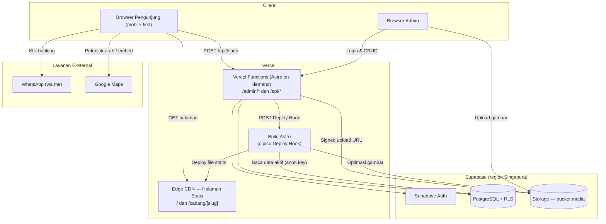
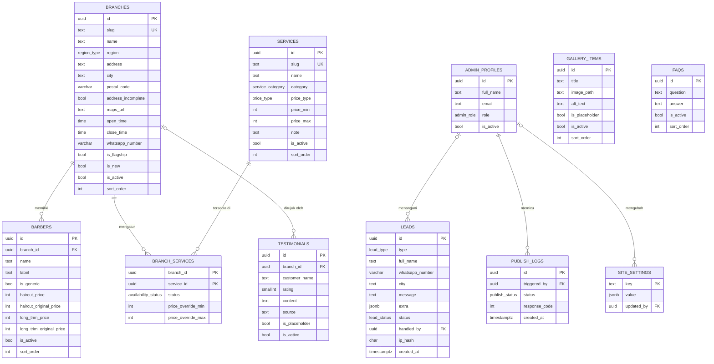
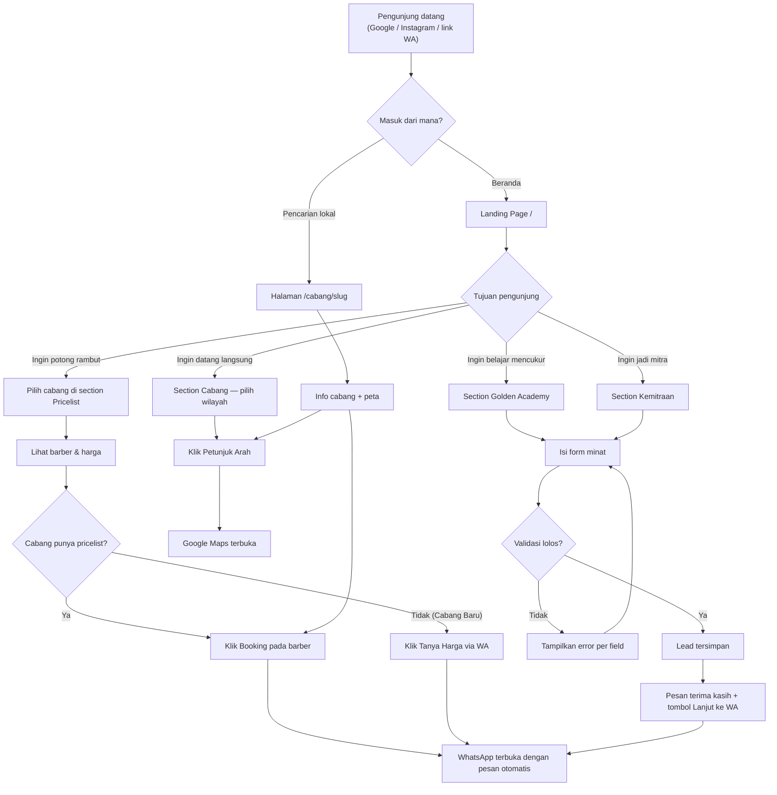
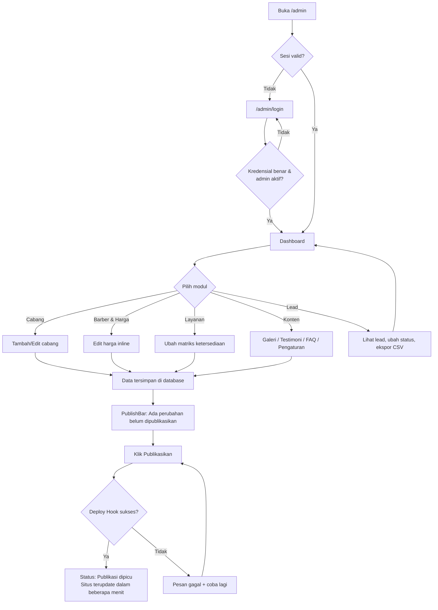
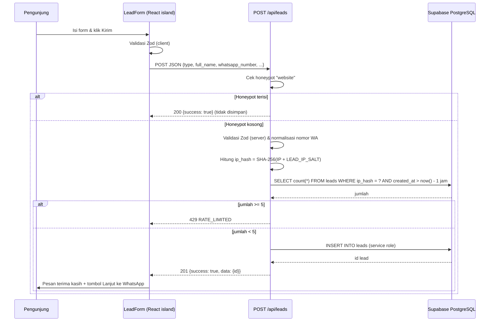
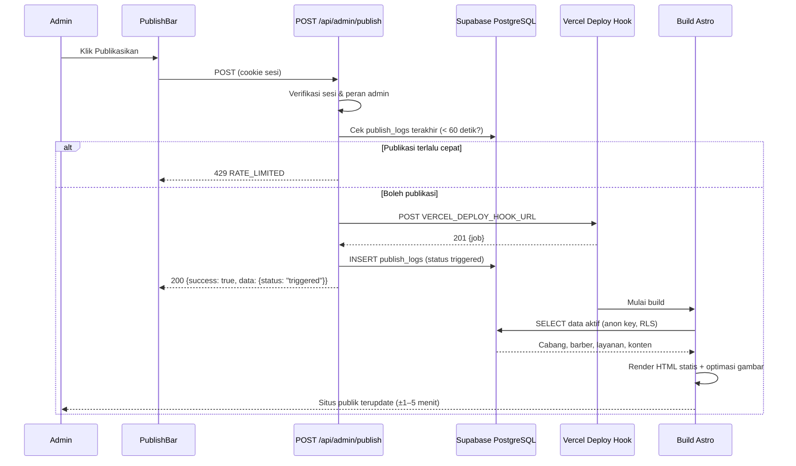
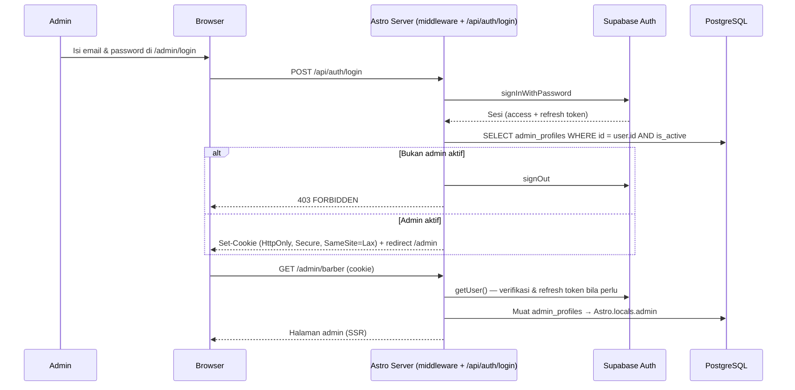

# 📄 Golden Barber Indonesia — Landing Page & Panel Admin — Product Requirement Document

> **Versi:** 1.0
> **Tanggal:** 4 November 2026
> **Author:** AI-Generated (Claude) berdasarkan riset publik & data dari pemilik proyek
> **Status:** Draft
> **Bahasa Dokumen:** Bahasa Indonesia

---

## Daftar Isi

1. [Overview & Requirements](#1-overview--requirements)
2. [Fitur Utama](#2-fitur-utama)
3. [Diagram Visual](#3-diagram-visual)
4. [Arahan Teknis](#4-arahan-teknis-technical-guidelines)
5. [Lampiran A — Data Seed Cabang, Barber & Harga](#lampiran-a--data-seed-cabang-barber--harga)
6. [Lampiran B — Pertanyaan Terbuka](#lampiran-b--pertanyaan-terbuka)

---

## 1. Overview & Requirements

### 1.1 Gambaran Umum Proyek

**Nama Proyek:** Golden Barber Indonesia — Landing Page & Panel Admin
**Deskripsi Singkat:** Website satu halaman (beserta halaman detail per cabang) untuk brand Golden Barber yang menampilkan 11 cabang, pricelist per cabang dan per barber, layanan, galeri, Golden Academy, dan kemitraan, dengan konversi utama berupa booking via WhatsApp. Website dilengkapi panel admin agar tim Golden Barber dapat mengelola data cabang, barber, harga, dan konten tanpa bantuan developer.
**Jenis Aplikasi:** Web App (landing page statis + panel admin server-rendered), mobile-first, responsif.

**Konteks brand (hasil riset):**
- Berawal dari Golden Barbershop Dipatiukur, Bandung (Jl. Dipatiukur No.57B2, dekat kampus Unpad).
- Rating Google cabang Dipatiukur: 4,9 dari ±3.340 ulasan (per November 2026).
- Pernah diliput sebagai barbershop langganan pemain Persib Bandung (Bola.net, 2016) dan pernah mengadakan program cukur gratis untuk 1.134 orang.
- Instagram resmi @goldenbarber_id (±17 ribu pengikut), Threads @goldenbarber_id, Linktree `linktr.ee/Goldenbarberindonesia`.
- Tagline pricelist resmi: **"Choose Your Haircut | The Winner's Cut"**.
- Memiliki akademi cukur: **Golden Academy** (@goldenacademybandung).
- Belum memiliki website resmi.

### 1.2 Latar Belakang & Tujuan

**Masalah yang Dipecahkan:**
- Informasi Golden Barber tersebar di artikel pihak ketiga yang datanya tidak konsisten (harga Rp25K–Rp85K, jam buka 07.00/08.00/11.00, alamat "57 i" vs "57B2").
- Pricelist hanya tersedia sebagai Instagram Story (10 slide) yang hilang dari tampilan publik setelah 24 jam, kecuali disimpan sebagai highlight, dan tidak bisa dicari di Google.
- Calon pelanggan sulit membandingkan cabang, barber, dan harga sebelum datang.
- Belum ada kanal resmi untuk menjaring calon murid Golden Academy dan calon mitra.
- Setiap perubahan harga/barber/cabang memerlukan desain ulang story; tidak ada sumber data tunggal.

**Tujuan Utama (urutan prioritas):**
1. Meningkatkan jumlah **booking via WhatsApp** dari website.
2. Mendorong **kunjungan langsung ke cabang** (alamat jelas, tombol petunjuk arah Google Maps).
3. Menjaring **pendaftar Golden Academy**.
4. Menjaring **calon mitra/kemitraan**.
5. Menjadi **sumber informasi resmi** yang mudah ditemukan di Google (SEO lokal per cabang).

**Indikator Keberhasilan (diukur setelah tracking aktif di M5):**
- Klik tombol WhatsApp per bulan (total dan per cabang).
- Klik "Petunjuk Arah" per cabang.
- Jumlah lead Academy dan kemitraan per bulan.
- Halaman cabang muncul di halaman 1 Google untuk kueri "barbershop + [nama area]" (contoh: "barbershop dipatiukur", "barbershop dago").

### 1.3 Target Pengguna

| Peran | Deskripsi | Kebutuhan Utama |
|-------|-----------|-----------------|
| Pengunjung — Calon Pelanggan | Pria 17–40 tahun di Bandung Raya & Jabodetabek (banyak mahasiswa di sekitar Dipatiukur/Dago), mayoritas mengakses dari HP | Menemukan cabang terdekat, melihat harga per barber, langsung booking via WA |
| Pengunjung — Calon Murid Academy | Orang yang ingin belajar mencukur/menjadi barber profesional | Info Golden Academy dan cara mendaftar |
| Pengunjung — Calon Mitra | Investor/pelaku usaha yang tertarik membuka cabang Golden Barber | Info kemitraan dan kanal kontak resmi |
| Admin — Super Admin | Pemilik/manajer Golden Barber | Kelola semua data, kelola akun admin, publikasikan perubahan |
| Admin — Editor | Staf yang ditunjuk mengurus konten | Kelola cabang, barber, harga, konten, dan lead; tidak bisa kelola akun admin |

### 1.4 Ruang Lingkup (Scope)

**Dalam Scope:**
- Landing page satu halaman (`/`) dengan section: Hero, Tentang & Keunggulan, Cabang, Pricelist, Layanan, Galeri, Testimoni, Golden Academy, Kemitraan, FAQ, Footer.
- Halaman detail per cabang (`/cabang/[slug]`) untuk SEO lokal.
- Tombol booking WhatsApp dengan pesan otomatis (umum, per cabang, per barber).
- Form minat Golden Academy dan Kemitraan, tersimpan di database.
- Panel admin (`/admin`): login, dashboard, CRUD cabang, barber & harga, layanan & ketersediaan per cabang, galeri, testimoni, FAQ, pengaturan situs, pengelolaan lead (termasuk ekspor CSV), publikasi perubahan, manajemen akun admin.
- SEO teknis: metadata, Open Graph, sitemap, robots.txt, structured data `HairSalon` per cabang.
- Foto dummy (placeholder) sampai foto asli tersedia.
- Deploy ke Vercel dengan subdomain sementara (`*.vercel.app`).

**Di Luar Scope (versi ini):**
- Booking online dengan pemilihan slot/jadwal dan pembayaran.
- Tracking analitik (GA4, Meta Pixel) — dijadwalkan di M5.
- Pembelian dan konfigurasi domain — dijadwalkan di M5.
- Multi-bahasa (hanya Bahasa Indonesia).
- Foto dan profil individual barber (datanya belum ada).
- Toko online produk (pomade, dll.).
- Aplikasi mobile native.
- Nomor WhatsApp berbeda per cabang (saat ini satu nomor untuk semua cabang; struktur data sudah mendukung jika nanti dibedakan).

### 1.5 Kebutuhan Fungsional

| ID | Kebutuhan | Prioritas | Deskripsi |
|----|-----------|-----------|-----------|
| FR-001 | Hero & navigasi | Must Have | Navbar sticky dengan logo, menu anchor ke setiap section, CTA "Booking via WA"; hero dengan tagline, statistik brand, dan dua CTA |
| FR-002 | Direktori cabang | Must Have | Menampilkan 11 cabang dikelompokkan per wilayah (Bandung Raya, Jabodetabek) dengan alamat, jam buka, tombol WA, dan tombol petunjuk arah |
| FR-003 | Pricelist per cabang & barber | Must Have | Pengunjung memilih cabang, lalu melihat daftar barber beserta harga Haircut Reguler dan Long Trim, termasuk harga coret (diskon) |
| FR-004 | Booking WhatsApp | Must Have | Setiap CTA booking membuka `wa.me` dengan pesan otomatis berisi konteks (cabang, barber, layanan, harga) |
| FR-005 | Katalog layanan standar | Must Have | Menampilkan Add-ons, Hair Colouring, Hair Treatment dengan harga dan status ketersediaan per cabang (Tersedia / Segera Hadir / Tidak Tersedia) |
| FR-006 | Section Golden Academy + form minat | Must Have | Deskripsi Academy (dapat diedit admin) dan form minat yang tersimpan sebagai lead tipe `academy` |
| FR-007 | Section Kemitraan + form minat | Must Have | Deskripsi kemitraan (dapat diedit admin) dan form minat yang tersimpan sebagai lead tipe `partnership` |
| FR-008 | SEO lokal | Must Have | Metadata per halaman, sitemap, structured data `HairSalon` per cabang, halaman `/cabang/[slug]` |
| FR-009 | Tentang & social proof | Should Have | Keunggulan brand, rating Google, cerita langganan pemain Persib, program cukur gratis |
| FR-010 | Galeri model rambut | Should Have | Grid foto model rambut dengan nama gaya dan deskripsi singkat |
| FR-011 | Testimoni | Should Have | Carousel/grid testimoni pelanggan yang dikelola admin |
| FR-012 | FAQ | Should Have | Accordion tanya-jawab yang dikelola admin |
| FR-013 | Halaman detail cabang | Should Have | Halaman per cabang berisi alamat, peta, jam buka, pricelist cabang, ketersediaan layanan |
| FR-014 | Login admin | Must Have | Autentikasi email + password, sesi berbasis cookie, proteksi seluruh rute `/admin` dan `/api/admin` |
| FR-015 | Kelola cabang | Must Have | CRUD cabang termasuk status aktif, badge "Cabang Baru", urutan tampil |
| FR-016 | Kelola barber & harga | Must Have | CRUD barber per cabang, harga Haircut Reguler & Long Trim, harga coret, urutan tampil, status aktif |
| FR-017 | Kelola layanan & ketersediaan | Must Have | CRUD layanan standar dan matriks ketersediaan per cabang |
| FR-018 | Kelola lead | Must Have | Melihat, memfilter, mengubah status, memberi catatan, dan ekspor CSV lead Academy & kemitraan |
| FR-019 | Publikasi perubahan | Must Have | Tombol "Publikasikan" yang memicu rebuild situs publik; indikator perubahan belum dipublikasikan |
| FR-020 | Kelola konten | Should Have | CRUD galeri (dengan upload gambar), testimoni, FAQ; edit pengaturan situs (teks hero, rating, teks Academy/Kemitraan, kontak) |
| FR-021 | Manajemen akun admin | Could Have | Super Admin dapat mengundang, mengubah peran, dan menonaktifkan akun admin |
| FR-022 | Tracking analitik | Won't Have (versi ini) | GA4 & Meta Pixel ditunda ke M5 |
| FR-023 | Booking slot online | Won't Have (versi ini) | Di luar scope |

### 1.6 Kebutuhan Non-Fungsional

| ID | Kategori | Kebutuhan | Detail |
|----|----------|-----------|--------|
| NFR-001 | Performa | Landing page cepat di jaringan seluler | Lighthouse mobile: Performance ≥ 90, LCP < 2,5 detik (simulasi 4G), CLS < 0,1, total JS halaman publik < 80 KB gzip |
| NFR-002 | Performa | Gambar teroptimasi | Semua gambar via `astro:assets` (WebP/AVIF, `srcset`, lazy-load di bawah fold); hero image ≤ 200 KB |
| NFR-003 | SEO | Mesin pencari dapat mengindeks seluruh konten | Konten publik dirender statis (HTML lengkap tanpa JS); Lighthouse SEO ≥ 95 |
| NFR-004 | Aksesibilitas | Standar WCAG 2.1 AA | Kontras teks ≥ 4.5:1, semua kontrol bisa diakses keyboard, `alt` untuk gambar, label form; Lighthouse Accessibility ≥ 95 |
| NFR-005 | Keamanan | Data admin terlindungi | Row Level Security (RLS) aktif di semua tabel; service role key hanya di server; cookie sesi `HttpOnly`, `Secure`, `SameSite=Lax` |
| NFR-006 | Keamanan | Form publik tahan spam | Honeypot field + rate limit 5 submit/jam per IP (hash) + validasi server (Zod) |
| NFR-007 | Keandalan | Situs publik tetap tersedia walau database bermasalah | Situs publik berupa file statis; jika build gagal, deployment sebelumnya tetap aktif |
| NFR-008 | Skalabilitas | Mendukung pertumbuhan cabang | Struktur data mendukung ≥ 50 cabang dan ≥ 500 barber tanpa perubahan skema |
| NFR-009 | Kompatibilitas | Browser modern | Chrome, Safari (iOS ≥ 15), Firefox, Edge, Samsung Internet — 2 versi terakhir; lebar layar 360px–1920px |
| NFR-010 | Maintainability | Kode mudah dilanjutkan | TypeScript strict, ESLint + Prettier, tipe database di-generate dari Supabase |
| NFR-011 | Privasi | Data lead dilindungi | Lead hanya dapat dibaca admin; IP tidak disimpan mentah (hanya hash SHA-256 + salt); kebijakan privasi singkat di footer |
| NFR-012 | Usability admin | Admin non-teknis dapat bekerja mandiri | Setiap aksi simpan menampilkan notifikasi sukses/gagal; aksi hapus membutuhkan konfirmasi; panel admin responsif (bisa dipakai di HP) |

### 1.7 Asumsi & Batasan

**Asumsi:**
- Data harga dan barber diambil dari Instagram Story "Pricelist" @goldenbarber_id (diposting sekitar Maret 2026) dan akan diverifikasi ulang oleh pemilik sebelum launch.
- Jam buka resmi semua cabang: **setiap hari 08.00–23.00 WIB** (sesuai pricelist dan bio Threads; Google Maps mencantumkan 07.00–23.55 untuk Dipatiukur — perlu konfirmasi).
- Satu nomor WhatsApp untuk semua cabang: **0812-1480-7192** (`6281214807192`).
- "By Barber" berarti pelanggan dilayani barber yang sedang tersedia (bukan memilih nama tertentu) — perlu konfirmasi.
- Klaim langganan pemain Persib ditampilkan sebagai liputan media dengan sumber, setelah dikonfirmasi pemilik.
- Logo yang tersedia berupa PNG (wordmark charcoal "GOLDEN" tebal + ikon clipper + "BARBER" tipis). Versi SVG diminta untuk kualitas terbaik.

**Batasan:**
- Belum ada foto asli interior, barber, maupun hasil potongan → menggunakan placeholder yang ditandai `is_placeholder` dan mudah diganti via admin.
- Belum ada data detail Golden Academy dan program kemitraan → section berupa deskripsi singkat + form minat; teks dapat diedit admin.
- Alamat lengkap cabang **Cihampelas** (hanya "Cipaganti, Kec. Coblong 40131") dan **Citra Raya** (belum ada data) belum tersedia.
- Cabang Citra Raya belum memiliki pricelist → ditampilkan dengan badge "Cabang Baru" dan CTA "Tanya via WhatsApp".
- Paket gratis Supabase: database 500 MB, storage 1 GB, project di-pause setelah 7 hari tanpa aktivitas → perlu upgrade ke Pro atau ping berkala sebelum produksi (lihat 4.7).

### 1.8 Tech Stack

| Layer | Teknologi | Justifikasi |
|-------|-----------|-------------|
| Framework | **Astro 5** (static output + rute on-demand) | Landing page dirender statis untuk performa & SEO maksimal; rute `/admin` dan `/api` dirender di server (`prerender = false`) |
| UI publik | Komponen `.astro` + **React island** untuk pemilih pricelist & form | JS hanya dimuat pada bagian interaktif (partial hydration) |
| UI admin | **React 19** island + **Tailwind CSS 4** + **TanStack Table** + **React Hook Form** | Tabel CRUD dan form kompleks dengan validasi |
| Validasi | **Zod** | Skema validasi yang sama dipakai di client dan server |
| Backend | **Astro API Routes** (Node runtime di Vercel Functions) | Endpoint admin & lead tanpa server terpisah |
| Database | **Supabase PostgreSQL** | Relasional (cabang → barber → harga), RLS bawaan, tipe TypeScript otomatis |
| Auth | **Supabase Auth** + `@supabase/ssr` | Login email/password, sesi cookie aman untuk SSR |
| Storage | **Supabase Storage** (bucket `media`) | Upload foto galeri & cabang dari admin |
| Deployment | **Vercel** + `@astrojs/vercel` | Gratis untuk skala ini, edge CDN cepat di Indonesia, Deploy Hook untuk rebuild saat publikasi |
| Testing | **Vitest** (unit) + **Playwright** (E2E) | Menguji util WhatsApp/format harga dan alur kritikal |
| Kualitas kode | TypeScript strict, ESLint, Prettier | Konsistensi & maintainability |

### 1.9 Milestone Pengembangan

Target selesai fleksibel; pekerjaan dibagi menjadi milestone berurutan. Estimasi dalam hari kerja untuk satu developer.

| Milestone | Nama | Estimasi | Deliverable | Definition of Done |
|-----------|------|----------|-------------|--------------------|
| **M1** | Fondasi & Landing Page | 7–10 hari | Setup proyek, design system (token warna, font, tekstur), seluruh section landing page dengan data dari file JSON lokal (seed Lampiran A) dan foto dummy, tombol WA berfungsi | Semua section tampil benar di 360px–1440px; pemilih pricelist berfungsi untuk 11 cabang; tautan WA membuka pesan yang benar |
| **M2** | Database & Data Asli | 4–6 hari | Project Supabase, migrasi skema, RLS, seed data 11 cabang/barber/harga/layanan, landing page membaca data dari Supabase saat build, halaman `/cabang/[slug]` | Build mengambil data dari Supabase; data identik dengan Lampiran A; RLS lolos uji (anon tidak bisa menulis) |
| **M3** | Panel Admin | 10–14 hari | Login, dashboard, CRUD cabang/barber/layanan/galeri/testimoni/FAQ, matriks ketersediaan, pengaturan situs, form lead + pengelolaan lead + ekspor CSV, publikasi via Deploy Hook, manajemen admin | Admin dapat mengubah harga barber lalu klik "Publikasikan" dan perubahan tampil di situs publik ≤ 5 menit |
| **M4** | QA, Optimasi & Launch | 4–5 hari | Uji E2E, audit Lighthouse, aksesibilitas, SEO (sitemap, JSON-LD), verifikasi data oleh pemilik, deploy produksi di `*.vercel.app` | Semua acceptance criteria Must Have lolos; Lighthouse sesuai NFR-001/003/004 |
| **M5** | Pasca-Launch (berkelanjutan) | — | Domain kustom, GA4 & Meta Pixel + event klik WA, foto asli, data Academy & kemitraan, alamat/pricelist Citra Raya & Cihampelas | Dikerjakan per item saat data/aset tersedia |

---

## 2. Fitur Utama

### 2.1 Ringkasan Fitur

| No | Fitur | Area | Prioritas | Milestone | Status |
|----|-------|------|-----------|-----------|--------|
| F-01 | Navigasi & Hero | Publik | 🔴 Must Have | M1 | Planned |
| F-02 | Direktori Cabang | Publik | 🔴 Must Have | M1 | Planned |
| F-03 | Pricelist per Cabang & Barber | Publik | 🔴 Must Have | M1 | Planned |
| F-04 | Booking via WhatsApp | Publik | 🔴 Must Have | M1 | Planned |
| F-05 | Katalog Layanan & Ketersediaan | Publik | 🔴 Must Have | M1 | Planned |
| F-06 | Golden Academy + Form Minat | Publik | 🔴 Must Have | M1 (UI), M3 (simpan) | Planned |
| F-07 | Kemitraan + Form Minat | Publik | 🔴 Must Have | M1 (UI), M3 (simpan) | Planned |
| F-08 | SEO Lokal & Metadata | Publik | 🔴 Must Have | M2 | Planned |
| F-09 | Tentang & Social Proof | Publik | 🟡 Should Have | M1 | Planned |
| F-10 | Galeri Model Rambut | Publik | 🟡 Should Have | M1 | Planned |
| F-11 | Testimoni | Publik | 🟡 Should Have | M1 | Planned |
| F-12 | FAQ | Publik | 🟡 Should Have | M1 | Planned |
| F-13 | Halaman Detail Cabang | Publik | 🟡 Should Have | M2 | Planned |
| F-14 | Autentikasi Admin | Admin | 🔴 Must Have | M3 | Planned |
| F-15 | Dashboard Admin | Admin | 🟡 Should Have | M3 | Planned |
| F-16 | Kelola Cabang | Admin | 🔴 Must Have | M3 | Planned |
| F-17 | Kelola Barber & Harga | Admin | 🔴 Must Have | M3 | Planned |
| F-18 | Kelola Layanan & Ketersediaan | Admin | 🔴 Must Have | M3 | Planned |
| F-19 | Kelola Lead | Admin | 🔴 Must Have | M3 | Planned |
| F-20 | Publikasi Perubahan | Admin | 🔴 Must Have | M3 | Planned |
| F-21 | Kelola Konten & Pengaturan Situs | Admin | 🟡 Should Have | M3 | Planned |
| F-22 | Manajemen Akun Admin | Admin | 🟢 Could Have | M3 | Planned |
| F-23 | Tracking GA4 & Meta Pixel | Publik | ⚪ Won't Have (versi ini) | M5 | Deferred |
| F-24 | Booking Slot Online | Publik | ⚪ Won't Have (versi ini) | — | Out of scope |

### 2.2 Detail Fitur

#### 2.2.1 F-01 — Navigasi & Hero

**Deskripsi:** Navbar sticky berisi logo Golden Barber (kiri), menu anchor (Cabang, Harga, Layanan, Galeri, Academy, Kemitraan, FAQ), dan tombol "Booking via WA" (kanan). Di mobile, menu berubah menjadi hamburger dengan drawer layar penuh. Hero menampilkan tagline, subjudul, dua CTA, dan tiga statistik brand. Tombol WhatsApp melayang (floating) tampil di pojok kanan bawah di semua halaman publik.

**Konten hero (default, dapat diedit admin):**
- Judul: "Choose Your Haircut. The Winner's Cut."
- Subjudul: "Berawal dari Dipatiukur, Bandung — kini hadir di 11 cabang di Bandung Raya & Jabodetabek. Buka setiap hari 08.00–23.00."
- CTA primer: "Booking via WhatsApp" → pesan umum (lihat F-04).
- CTA sekunder: "Cari Cabang Terdekat" → scroll ke section Cabang.
- Statistik: "11 Cabang" (dihitung otomatis dari cabang aktif), "4,9★ Google Rating" (dari pengaturan), "Buka Setiap Hari 08.00–23.00".

**User Stories:**
- Sebagai calon pelanggan, saya ingin langsung melihat tombol booking di layar pertama, agar saya bisa memesan tanpa menggulir.
- Sebagai calon pelanggan, saya ingin menu yang membawa saya ke bagian harga atau cabang, agar saya cepat menemukan informasi yang dicari.

**Acceptance Criteria:**
- [ ] Navbar tetap terlihat (sticky) saat halaman digulir dan memiliki latar solid setelah scroll > 80px.
- [ ] Klik item menu melakukan smooth scroll ke section terkait dan menutup drawer mobile.
- [ ] Jumlah cabang di statistik hero sama dengan jumlah cabang `is_active = true`.
- [ ] Tombol WhatsApp melayang tidak menutupi tombol lain di layar 360px dan memiliki `aria-label="Booking via WhatsApp"`.
- [ ] Hero image memuat dengan `fetchpriority="high"` dan LCP < 2,5 detik.

**Catatan Teknis:**
- Hero, navbar, dan floating button adalah komponen `.astro`; toggle drawer memakai skrip inline kecil (tanpa framework).
- Menu aktif disorot memakai `IntersectionObserver`.

---

#### 2.2.2 F-02 — Direktori Cabang

**Deskripsi:** Section "Cabang Kami" menampilkan tab wilayah **Bandung Raya** (7 cabang) dan **Jabodetabek** (4 cabang). Setiap kartu cabang memuat nama, alamat, jam buka, badge (mis. "Pusat" untuk Dipatiukur, "Cabang Baru" untuk Citra Raya), tombol **Booking WA**, tombol **Petunjuk Arah** (Google Maps), dan tautan **Lihat Harga** (memilih cabang tersebut di section Pricelist) serta **Detail Cabang** (`/cabang/[slug]`).

**User Stories:**
- Sebagai calon pelanggan di Bandung, saya ingin melihat cabang yang dekat dengan saya, agar saya tidak perlu pergi jauh.
- Sebagai calon pelanggan, saya ingin langsung membuka petunjuk arah ke cabang, agar mudah datang langsung.
- Sebagai calon pelanggan di Tangerang, saya ingin tahu bahwa Golden juga ada di Jabodetabek, agar saya bisa mencoba tanpa ke Bandung.

**Acceptance Criteria:**
- [ ] Tab default adalah "Bandung Raya"; jumlah cabang per tab ditampilkan pada label tab (mis. "Bandung Raya (7)").
- [ ] Urutan kartu mengikuti `sort_order` dari database.
- [ ] Tombol "Petunjuk Arah" membuka `maps_url` cabang di tab baru; jika `maps_url` kosong, dibuat dari alamat: `https://www.google.com/maps/search/?api=1&query={encodeURIComponent(nama + alamat)}`.
- [ ] Cabang dengan alamat belum lengkap (`address_incomplete = true`) menampilkan catatan "Alamat lengkap: tanyakan via WhatsApp".
- [ ] Cabang `is_new = true` menampilkan badge "Cabang Baru".
- [ ] Klik "Lihat Harga" men-scroll ke section Pricelist dan memilih cabang tersebut.

**Catatan Teknis:**
- Tab wilayah dirender statis (semua kartu ada di HTML) dan disembunyikan/ditampilkan dengan skrip kecil agar tetap terindeks.
- Wilayah disimpan di kolom `region` (`bandung_raya` | `jabodetabek`).

---

#### 2.2.3 F-03 — Pricelist per Cabang & Barber

**Deskripsi:** Section "Pilih Barbermu" menampilkan pemilih cabang (dropdown di mobile, chip horizontal di desktop). Setelah cabang dipilih, tampil tabel barber berisi nama, harga **Haircut Reguler**, harga **Long Trim**, dan tombol **Booking** per barber. Di atas tabel tampil daftar "Sudah termasuk": Konsultasi, Hairwash 1–2x, Pengaplikasian produk jika perlu, Hair Styling. Harga coret (mis. ~~150K~~ **130K**) ditampilkan jika `haircut_original_price` terisi.

**User Stories:**
- Sebagai calon pelanggan, saya ingin melihat harga setiap barber di cabang pilihan saya, agar bisa memilih sesuai budget.
- Sebagai calon pelanggan, saya ingin langsung booking barber tertentu dari tabel harga, agar admin WA tahu siapa yang saya pilih.
- Sebagai calon pelanggan, saya ingin tahu apa saja yang sudah termasuk dalam harga, agar tidak ada biaya kejutan.

**Acceptance Criteria:**
- [ ] Cabang default yang terpilih adalah cabang dengan `is_flagship = true` (Dipatiukur).
- [ ] Pilihan cabang tersimpan di URL hash/query (`?cabang=dago#harga`) sehingga tautan dapat dibagikan dan dibuka langsung pada cabang tersebut.
- [ ] Barber ditampilkan urut `sort_order`; barber `is_active = false` tidak tampil.
- [ ] Harga ditampilkan dalam format pricelist brand ("130K") dengan `aria-label` lengkap ("Rp130.000").
- [ ] Barber bertipe `is_generic = true` ("By Barber") menampilkan tooltip/keterangan "Dilayani barber yang tersedia".
- [ ] Jika cabang belum punya barber (mis. Citra Raya), tampil pesan "Pricelist cabang ini segera hadir" + tombol "Tanya Harga via WhatsApp".
- [ ] Rentang harga cabang (mis. "Mulai 85K") ditampilkan di samping nama cabang pada pemilih.

**Catatan Teknis:**
- Komponen `PricelistPicker.tsx` (React island, `client:visible`) menerima seluruh data pricelist sebagai props saat build (±70 baris barber, < 10 KB JSON).
- HTML statis awal berisi tabel cabang default agar konten terindeks walau JS belum dimuat.
- Format harga: `formatPriceShort(130000) → "130K"`, `formatRupiah(130000) → "Rp130.000"` di `src/lib/format.ts`.

---

#### 2.2.4 F-04 — Booking via WhatsApp

**Deskripsi:** Semua CTA booking membuka `https://wa.me/{nomor}?text={pesan}` di tab baru dengan pesan otomatis sesuai konteks. Nomor diambil dari `branches.whatsapp_number` jika terisi, jika tidak dari `site_settings.whatsapp_number` (`6281214807192`).

**Template pesan:**

| Konteks | Template |
|---------|----------|
| Umum (hero, navbar, floating) | `Halo Golden Barber, saya mau booking potong rambut. Cabang yang tersedia di dekat saya apa saja ya?` |
| Per cabang | `Halo Golden Barber {nama_cabang}, saya mau booking potong rambut. Apakah ada slot hari ini?` |
| Per barber | `Halo Golden Barber {nama_cabang}, saya mau booking {layanan} dengan barber {nama_barber} ({harga}). Kapan slot yang tersedia?` |
| Per layanan | `Halo Golden Barber, saya mau tanya layanan {nama_layanan} di cabang {nama_cabang}.` |
| Cabang tanpa pricelist | `Halo Golden Barber {nama_cabang}, boleh minta info pricelist dan alamat lengkap cabang ini?` |
| Setelah submit form Academy | `Halo Golden Academy, saya {nama} baru saja mengisi form minat di website. Saya ingin info kelas.` |
| Setelah submit form Kemitraan | `Halo Golden Barber, saya {nama} baru saja mengisi form kemitraan di website. Saya ingin info kemitraan.` |

**User Stories:**
- Sebagai calon pelanggan, saya ingin pesan WA sudah terisi otomatis, agar saya tidak perlu mengetik detail booking.
- Sebagai admin WhatsApp Golden, saya ingin pesan masuk sudah menyebut cabang dan barber, agar saya bisa langsung meneruskan ke cabang terkait.

**Acceptance Criteria:**
- [ ] Semua tautan WA memakai format `https://wa.me/6281214807192?text=...` dengan teks ter-encode (`encodeURIComponent`).
- [ ] Placeholder `{nama_cabang}`, `{nama_barber}`, `{layanan}`, `{harga}` terisi benar; tidak ada placeholder mentah yang lolos ke pesan.
- [ ] Template pesan dapat diubah admin di Pengaturan Situs; placeholder yang tidak dikenal ditolak saat simpan.
- [ ] Tautan memiliki `target="_blank"` dan `rel="noopener"`.
- [ ] Setiap tautan WA memiliki atribut `data-wa-context` (`general|branch|barber|service|academy|partnership`) dan `data-branch` untuk tracking di M5.

**Catatan Teknis:**
- Satu fungsi `buildWhatsAppUrl({ context, branch, barber, service, price, name })` di `src/lib/whatsapp.ts` dengan unit test.
- Normalisasi nomor: hapus spasi/tanda hubung, ganti awalan `0` → `62`.

---

#### 2.2.5 F-05 — Katalog Layanan & Ketersediaan

**Deskripsi:** Section "Layanan" menampilkan tiga kelompok layanan standar dengan harga yang sama di semua cabang: **Add-ons**, **Hair Colouring**, **Hair Treatment**. Status layanan mengikuti cabang yang sedang dipilih di section Pricelist: *Tersedia*, *Segera Hadir* (pricelist: "SOON"), atau disembunyikan jika *Tidak Tersedia*. Harga bertipe "mulai dari" diberi label "Mulai".

**User Stories:**
- Sebagai calon pelanggan, saya ingin melihat harga colouring dan perming, agar tahu perkiraan biaya sebelum datang.
- Sebagai calon pelanggan, saya ingin tahu apakah layanan tertentu tersedia di cabang pilihan saya, agar tidak kecewa saat datang.

**Acceptance Criteria:**
- [ ] Harga tampil sesuai tipe: `fixed` → "125K", `start_from` → "Mulai 350K", `range` → "150K–300K".
- [ ] Layanan berstatus `soon` di cabang terpilih menampilkan badge "Segera Hadir" dan tidak menampilkan tombol tanya.
- [ ] Layanan berstatus `unavailable` di cabang terpilih tidak ditampilkan.
- [ ] Jika `price_override` terisi untuk suatu cabang, harga override yang ditampilkan.
- [ ] Setiap layanan tersedia memiliki tautan "Tanya" ke WA (konteks `service`).

**Catatan Teknis:**
- Data layanan + matriks `branch_services` dikirim ke island yang sama dengan pricelist (state cabang terpilih dibagi lewat store kecil, mis. `nanostores`).

---

#### 2.2.6 F-06 — Golden Academy + Form Minat

**Deskripsi:** Section "Golden Academy — Tempat Belajar Nyukur" berisi deskripsi singkat (dapat diedit admin), tautan Instagram @goldenacademybandung, dan form minat. Karena detail kelas belum tersedia, form berfungsi menjaring calon murid untuk dihubungi.

**Field form Academy:**

| Field | Tipe | Wajib | Validasi |
|-------|------|-------|----------|
| Nama lengkap | text | Ya | 2–100 karakter |
| Nomor WhatsApp | tel | Ya | Format Indonesia, 10–15 digit, dinormalisasi ke `62...` |
| Kota domisili | text | Ya | 2–100 karakter |
| Usia | number | Tidak | 15–60 |
| Pengalaman mencukur | select | Ya | `belum_pernah` / `dasar` / `sudah_bekerja` |
| Pesan/pertanyaan | textarea | Tidak | ≤ 1000 karakter |
| `website` (honeypot) | hidden | — | Harus kosong |

**User Stories:**
- Sebagai calon murid, saya ingin mendaftarkan minat belajar mencukur, agar dihubungi tim Golden Academy.
- Sebagai admin, saya ingin data calon murid tersimpan rapi, agar mudah di-follow up.

**Acceptance Criteria:**
- [ ] Submit valid menyimpan lead dengan `type = 'academy'` dan `status = 'new'`.
- [ ] Setelah sukses, form diganti pesan terima kasih + tombol "Lanjutkan via WhatsApp" (template Academy, F-04).
- [ ] Error validasi ditampilkan per field dalam Bahasa Indonesia.
- [ ] Submit ke-6 dari IP yang sama dalam 1 jam ditolak dengan pesan "Terlalu banyak percobaan, coba lagi nanti".
- [ ] Jika honeypot terisi, server mengembalikan sukses palsu tanpa menyimpan data.
- [ ] Persetujuan "Data saya boleh dihubungi oleh tim Golden Barber" (checkbox wajib) disertakan.

**Catatan Teknis:**
- Komponen `LeadForm.tsx` dipakai bersama untuk Academy & Kemitraan dengan prop `type`.
- POST ke `/api/leads` (on-demand route). Di M1 (sebelum database), form menampilkan UI lengkap dan langsung mengarahkan ke WA.

---

#### 2.2.7 F-07 — Kemitraan + Form Minat

**Deskripsi:** Section "Buka Golden Barber di Kotamu" berisi narasi pertumbuhan brand (11 cabang di 2 provinsi + DKI Jakarta) dan form minat kemitraan. Teks dapat diedit admin.

**Field form Kemitraan:**

| Field | Tipe | Wajib | Validasi |
|-------|------|-------|----------|
| Nama lengkap | text | Ya | 2–100 karakter |
| Nomor WhatsApp | tel | Ya | Sama seperti Academy |
| Email | email | Tidak | Format email valid |
| Kota rencana lokasi | text | Ya | 2–100 karakter |
| Status lokasi | select | Ya | `sudah_ada` / `belum_ada` |
| Pesan/pertanyaan | textarea | Tidak | ≤ 1000 karakter |
| Persetujuan dihubungi | checkbox | Ya | Harus dicentang |
| `website` (honeypot) | hidden | — | Harus kosong |

**User Stories:**
- Sebagai calon mitra, saya ingin mengirim minat kemitraan secara resmi, agar dihubungi pihak manajemen.
- Sebagai pemilik, saya ingin melihat daftar calon mitra beserta kota rencananya, agar bisa memprioritaskan ekspansi.

**Acceptance Criteria:**
- [ ] Submit valid menyimpan lead `type = 'partnership'`; field `email` dan `location_status` disimpan di kolom `extra` (JSONB).
- [ ] Perilaku sukses, error, rate limit, dan honeypot identik dengan F-06.
- [ ] Statistik jumlah cabang di section ini dihitung otomatis dari database.

**Catatan Teknis:**
- Lihat F-06; skema Zod berbeda per `type` menggunakan `z.discriminatedUnion('type', [...])`.

---

#### 2.2.8 F-08 — SEO Lokal & Metadata

**Deskripsi:** Optimasi agar Golden Barber dan setiap cabangnya mudah ditemukan di Google.

**User Stories:**
- Sebagai calon pelanggan, saya ingin menemukan Golden Barber saat mencari "barbershop dago" di Google, agar tahu ada cabang di dekat saya.
- Sebagai pemilik, saya ingin tautan website terlihat menarik saat dibagikan di WhatsApp/Instagram, agar orang tertarik membuka.

**Acceptance Criteria:**
- [ ] Setiap halaman memiliki `<title>` unik (≤ 60 karakter) dan `meta description` (≤ 160 karakter); contoh: "Golden Barber Dago — Barbershop di Jl. Ir. H. Juanda, Bandung".
- [ ] Tag Open Graph & Twitter Card lengkap dengan gambar OG 1200×630.
- [ ] `sitemap.xml` (via `@astrojs/sitemap`) memuat `/` dan semua `/cabang/[slug]` aktif; `robots.txt` mengecualikan `/admin` dan `/api`.
- [ ] Setiap halaman cabang memuat JSON-LD `HairSalon` dengan `name`, `address` (`PostalAddress`), `telephone`, `openingHoursSpecification` (Mo–Su 08:00–23:00), `priceRange`, `url`, `sameAs` (Instagram); halaman utama memuat JSON-LD `Organization` dengan `department` berisi seluruh cabang.
- [ ] Atribut `lang="id"` pada `<html>`, URL kanonis di setiap halaman.
- [ ] Lolos Google Rich Results Test tanpa error.

**Catatan Teknis:**
- Util `buildHairSalonJsonLd(branch)` dan `buildOrganizationJsonLd(branches)` di `src/lib/seo.ts`.
- `aggregateRating` hanya dicantumkan jika data ulasan valid dan diizinkan (default tidak dicantumkan untuk menghindari penalti).

---

#### 2.2.9 F-09 — Tentang & Social Proof

**Deskripsi:** Section "Kenapa Golden?" berisi 4–6 poin keunggulan dan blok social proof.

**Konten default (dapat diedit admin, perlu konfirmasi pemilik):**
- **Konsultasi gratis** — setiap potongan diawali konsultasi gaya rambut.
- **Sudah termasuk hairwash & styling** — tanpa biaya tambahan.
- **Buka sampai malam** — setiap hari 08.00–23.00.
- **Pilih barbermu sendiri** — harga transparan per barber.
- **Dipercaya pemain Persib** — pernah diliput sebagai barbershop langganan pemain Persib Bandung (sumber: Bola.net).
- **Peduli sesama** — pernah menggelar program cukur gratis untuk 1.134 orang.
- Blok rating: "4,9★ dari 3.340+ ulasan Google (cabang Dipatiukur)" — angka dan tanggal dari pengaturan situs.

**User Stories:**
- Sebagai calon pelanggan baru, saya ingin melihat bukti kualitas Golden, agar yakin mencoba.

**Acceptance Criteria:**
- [ ] Angka rating dan jumlah ulasan diambil dari `site_settings` dan disertai label sumber + tanggal pembaruan.
- [ ] Klaim berbasis liputan media disertai tautan sumber.
- [ ] Poin keunggulan dapat diubah, ditambah, atau diurutkan ulang dari admin (disimpan sebagai array JSON di `site_settings`).

**Catatan Teknis:**
- Disimpan pada key `about_highlights` (JSONB array `{icon, title, description}`) dan `google_rating`, `google_review_count`, `google_rating_updated_at`.

---

#### 2.2.10 F-10 — Galeri Model Rambut

**Deskripsi:** Grid foto model rambut (mis. "Messy Fringe w/ Korean Taper", "French Crop", "Two Block", "Comma Hair", "Buzz Cut", "Mullet") dengan nama gaya dan deskripsi singkat. Klik foto membuka lightbox. Foto awal berupa placeholder.

**User Stories:**
- Sebagai calon pelanggan, saya ingin melihat contoh model rambut, agar punya referensi saat konsultasi.
- Sebagai admin, saya ingin mengunggah foto hasil potongan asli, agar galeri menggantikan foto dummy.

**Acceptance Criteria:**
- [ ] Menampilkan maksimal 12 item aktif urut `sort_order`; grid 2 kolom (mobile), 3 (tablet), 4 (desktop).
- [ ] Lightbox dapat ditutup dengan tombol, klik latar, dan tombol `Esc`; navigasi kiri/kanan dengan keyboard.
- [ ] Item `is_placeholder = true` diberi label kecil "Ilustrasi" agar tidak menyesatkan.
- [ ] Setiap foto memiliki `alt` deskriptif (wajib diisi di admin).

**Catatan Teknis:**
- Gambar dari Supabase Storage dioptimasi saat build dengan `astro:assets` (remote image domain diizinkan di `astro.config.mjs`).
- Placeholder disimpan lokal di `public/images/dummy/` (gambar bebas lisensi, mis. Unsplash, atau ilustrasi SVG).

---

#### 2.2.11 F-11 — Testimoni

**Deskripsi:** Carousel testimoni (nama, cabang, rating bintang, isi, sumber). Testimoni dimasukkan manual oleh admin.

**User Stories:**
- Sebagai calon pelanggan, saya ingin membaca pengalaman pelanggan lain, agar yakin dengan kualitas barber.

**Acceptance Criteria:**
- [ ] Menampilkan testimoni `is_active = true` urut `sort_order`, maksimal 10.
- [ ] Carousel dapat digeser (swipe) di mobile dan memiliki tombol navigasi yang dapat diakses keyboard; tidak auto-play.
- [ ] Nama ditampilkan sesuai yang diinput admin (disarankan inisial nama belakang, mis. "Rizky A.").
- [ ] Testimoni dummy diberi `is_placeholder = true` dan wajib diganti sebelum launch produksi (checklist M4).

**Catatan Teknis:**
- Carousel memakai CSS scroll-snap (tanpa library) agar ringan.
- Testimoni dari ulasan Google hanya dimasukkan dengan izin penulis atau diparafrasekan; tidak menyalin massal.

---

#### 2.2.12 F-12 — FAQ

**Deskripsi:** Accordion tanya-jawab. Konten awal (perlu dikonfirmasi pemilik):

| Pertanyaan | Jawaban draf |
|------------|--------------|
| Jam buka Golden Barber? | Semua cabang buka setiap hari pukul 08.00–23.00 WIB. |
| Bagaimana cara booking? | Klik tombol "Booking via WhatsApp", pilih cabang dan barber, lalu admin akan mengonfirmasi slot. |
| Apa yang sudah termasuk dalam harga haircut? | Konsultasi, hairwash 1–2x, pengaplikasian produk jika perlu, dan hair styling. |
| Apa itu "By Barber"? | Anda akan dilayani barber yang sedang tersedia saat itu. *(konfirmasi)* |
| Kenapa harga tiap barber berbeda? | Harga menyesuaikan pengalaman dan tingkat keahlian masing-masing barber. *(konfirmasi)* |
| Apa arti "Segera Hadir" pada layanan? | Layanan tersebut sedang disiapkan di cabang itu dan belum bisa dipesan. |
| Apakah bisa datang tanpa booking (walk-in)? | *(menunggu konfirmasi pemilik)* |
| Metode pembayaran apa saja yang diterima? | *(menunggu konfirmasi pemilik)* |

**User Stories:**
- Sebagai calon pelanggan, saya ingin menemukan jawaban pertanyaan umum, agar tidak perlu bertanya lewat WA.

**Acceptance Criteria:**
- [ ] Accordion menggunakan elemen `<details>/<summary>` (berfungsi tanpa JS).
- [ ] FAQ dengan jawaban kosong atau `is_active = false` tidak ditampilkan.
- [ ] Halaman memuat JSON-LD `FAQPage` sesuai FAQ yang tampil.

**Catatan Teknis:**
- Disimpan di tabel `faqs`; draf yang berlabel konfirmasi di-seed dengan `is_active = false`.

---

#### 2.2.13 F-13 — Halaman Detail Cabang

**Deskripsi:** Halaman statis per cabang `/cabang/[slug]` (mis. `/cabang/dipatiukur`, `/cabang/dago`) berisi: nama & badge, alamat lengkap, jam buka, embed Google Maps (iframe lazy), tombol WA & petunjuk arah, foto cabang (placeholder), pricelist barber cabang, matriks layanan cabang, dan daftar cabang lain di wilayah yang sama.

**User Stories:**
- Sebagai calon pelanggan yang mencari dari Google, saya ingin langsung masuk ke halaman cabang terdekat, agar informasinya fokus.
- Sebagai pemilik, saya ingin setiap cabang punya halaman sendiri, agar peluang muncul di pencarian lokal lebih besar.

**Acceptance Criteria:**
- [ ] Halaman dibuat untuk setiap cabang `is_active = true` saat build (`getStaticPaths`).
- [ ] Slug unik, huruf kecil, tanpa spasi (mis. `pasgar-tki-2`, `graha-raya`).
- [ ] Iframe peta memakai `loading="lazy"` dan tidak dimuat jika `maps_embed_url` kosong (diganti tombol "Buka di Google Maps").
- [ ] Slug yang tidak ada mengarah ke halaman 404 berdesain brand dengan tautan ke daftar cabang.

**Catatan Teknis:**
- Komponen pricelist & layanan dipakai ulang dari F-03/F-05 dalam mode cabang tunggal (tanpa pemilih).

---

#### 2.2.14 F-14 — Autentikasi Admin

**Deskripsi:** Halaman `/admin/login` dengan email & password via Supabase Auth. Tidak ada registrasi publik; akun dibuat oleh Super Admin (F-22) atau via dashboard Supabase untuk akun pertama.

**User Stories:**
- Sebagai admin, saya ingin login dengan email dan password, agar hanya orang berwenang yang bisa mengubah data.
- Sebagai admin, saya ingin bisa reset password, agar tetap bisa masuk jika lupa.

**Acceptance Criteria:**
- [ ] Akses ke `/admin/*` (selain `/admin/login` dan `/admin/reset-password`) tanpa sesi valid diarahkan ke `/admin/login?redirect={path}`.
- [ ] Login gagal menampilkan "Email atau password salah" tanpa membedakan penyebab.
- [ ] Pengguna yang login tetapi tidak memiliki baris di `admin_profiles` atau `is_active = false` ditolak (403) dan sesinya dihapus.
- [ ] Tombol "Lupa password" mengirim email reset via Supabase; tautan reset mengarah ke `/admin/reset-password`.
- [ ] Logout menghapus cookie sesi dan mengarahkan ke `/admin/login`.
- [ ] Sesi diperbarui otomatis (refresh token) selama admin aktif.

**Catatan Teknis:**
- `src/middleware.ts` membuat Supabase server client (`@supabase/ssr`) per request, memverifikasi `supabase.auth.getUser()`, memuat `admin_profiles`, dan menaruhnya di `Astro.locals.admin`.
- 5 kali gagal login dalam 15 menit dari IP yang sama → tunda 15 menit (rate limit bawaan Supabase Auth + pengecekan tambahan di endpoint).

---

#### 2.2.15 F-15 — Dashboard Admin

**Deskripsi:** Halaman `/admin` menampilkan ringkasan: jumlah cabang aktif, jumlah barber aktif, lead baru (Academy & Kemitraan), status publikasi terakhir, dan pintasan ke aksi umum.

**User Stories:**
- Sebagai pemilik, saya ingin melihat ringkasan kondisi website dan lead baru begitu login, agar tahu apa yang perlu ditindaklanjuti.

**Acceptance Criteria:**
- [ ] Menampilkan 4 kartu statistik: Cabang Aktif, Barber Aktif, Lead Baru (status `new`), Publikasi Terakhir (waktu + status).
- [ ] Menampilkan 5 lead terbaru dengan tautan ke detail.
- [ ] Menampilkan banner "Ada perubahan yang belum dipublikasikan" jika berlaku (lihat F-20).

**Catatan Teknis:**
- Data diambil server-side di frontmatter halaman `.astro` (SSR).

---

#### 2.2.16 F-16 — Kelola Cabang

**Deskripsi:** Halaman `/admin/cabang` berisi tabel cabang (nama, wilayah, kota, jumlah barber, status) dan form tambah/edit.

**Field cabang:** nama, slug (otomatis dari nama, bisa diubah), wilayah, alamat, kecamatan, kota/kabupaten, provinsi, kode pos, `address_incomplete`, URL Google Maps, URL embed peta, latitude, longitude, jam buka, jam tutup, nomor WA khusus (opsional), `is_flagship`, `is_new`, `is_active`, urutan, foto cabang, catatan internal.

**User Stories:**
- Sebagai admin, saya ingin menambah cabang baru (mis. Citra Raya) beserta alamatnya, agar langsung tampil di website setelah dipublikasikan.
- Sebagai admin, saya ingin menonaktifkan cabang yang tutup tanpa menghapus datanya, agar riwayat tetap ada.
- Sebagai admin, saya ingin mengatur urutan cabang, agar cabang utama tampil lebih dulu.

**Acceptance Criteria:**
- [ ] Slug divalidasi unik; bentrok mengembalikan error `CONFLICT` dengan pesan "Slug sudah dipakai cabang lain".
- [ ] Hanya satu cabang yang boleh `is_flagship = true`; mengaktifkan di cabang lain otomatis menonaktifkan yang lama (dengan konfirmasi).
- [ ] Hapus cabang hanya diizinkan jika tidak memiliki barber; jika ada, admin diminta menonaktifkan atau memindahkan barber dulu.
- [ ] Urutan dapat diubah dengan drag-and-drop atau tombol naik/turun, tersimpan ke `sort_order`.
- [ ] Jam tutup harus lebih besar dari jam buka (validasi form).

**Catatan Teknis:**
- Slug di-generate dengan util `slugify` (hapus diakritik, ganti spasi dengan `-`).

---

#### 2.2.17 F-17 — Kelola Barber & Harga

**Deskripsi:** Halaman `/admin/barber` dengan filter cabang. Tabel barber dapat diedit inline: nama, harga Haircut Reguler, harga coret Haircut Reguler, harga Long Trim, harga coret Long Trim, tipe generik ("By Barber"), status aktif, urutan. Tersedia aksi **Pindahkan ke cabang lain**.

**User Stories:**
- Sebagai admin, saya ingin mengubah harga barber langsung dari tabel, agar update pricelist cepat.
- Sebagai admin, saya ingin memasang harga coret untuk promo barber tertentu, agar pelanggan melihat diskon.
- Sebagai admin, saya ingin memindahkan barber ke cabang lain, agar data tetap akurat saat rotasi.

**Acceptance Criteria:**
- [ ] Harga disimpan dalam rupiah penuh (integer, mis. 130000); input menerima "130K", "130.000", atau "130000" dan dinormalisasi.
- [ ] Harga coret wajib lebih besar dari harga aktual; jika tidak, error validasi.
- [ ] Harga minimal Rp10.000 dan maksimal Rp10.000.000.
- [ ] Perubahan inline tersimpan saat sel kehilangan fokus atau menekan Enter, dengan indikator "Tersimpan".
- [ ] Barber `is_generic = true` boleh lebih dari satu per cabang (mis. dua "By Barber" di Dago dengan harga berbeda); kolom `label` opsional untuk membedakan di admin.
- [ ] Aksi "Duplikasi harga dari barber lain" tersedia untuk mempercepat input.

**Catatan Teknis:**
- Endpoint PATCH per baris; `updated_at` diperbarui trigger database.

---

#### 2.2.18 F-18 — Kelola Layanan & Ketersediaan

**Deskripsi:** Halaman `/admin/layanan` terdiri dari dua tab: **Katalog Layanan** (CRUD layanan standar: nama, kategori, tipe harga, harga min, harga max, deskripsi, urutan, aktif) dan **Ketersediaan per Cabang** (matriks: baris = layanan, kolom = cabang, sel = dropdown Tersedia / Segera Hadir / Tidak Tersedia + override harga opsional).

**User Stories:**
- Sebagai admin, saya ingin mengubah status perming di cabang Condet dari "Segera Hadir" menjadi "Tersedia", agar pelanggan tahu layanan sudah bisa dipesan.
- Sebagai admin, saya ingin menambah layanan baru (mis. Hair Spa), agar katalog selalu terkini.

**Acceptance Criteria:**
- [ ] Layanan baru otomatis dibuatkan baris `branch_services` untuk semua cabang dengan status default `unavailable`.
- [ ] Cabang baru otomatis dibuatkan baris `branch_services` untuk semua layanan dengan status default `unavailable`.
- [ ] Matriks dapat di-scroll horizontal di mobile dengan kolom layanan tetap (sticky).
- [ ] Tombol "Terapkan ke semua cabang" untuk satu baris layanan.
- [ ] Tipe harga `range` wajib mengisi harga max > harga min; tipe `fixed`/`start_from` mengabaikan harga max.

**Catatan Teknis:**
- Penyimpanan matriks memakai satu endpoint bulk upsert per cabang (`PUT /api/admin/branches/:id/services`).
- Pembuatan baris otomatis via trigger database (`after insert on services` / `after insert on branches`).

---

#### 2.2.19 F-19 — Kelola Lead

**Deskripsi:** Halaman `/admin/leads` menampilkan tabel lead dengan tab **Academy** dan **Kemitraan**, filter status (`new`, `contacted`, `closed`, `spam`), pencarian nama/nomor, dan detail lead (semua field + catatan admin).

**User Stories:**
- Sebagai admin, saya ingin melihat calon murid dan calon mitra yang baru mendaftar, agar bisa segera dihubungi.
- Sebagai admin, saya ingin menandai lead yang sudah dihubungi dan menulis catatan, agar tim tidak menghubungi dua kali.
- Sebagai pemilik, saya ingin mengekspor lead ke CSV, agar bisa diolah di spreadsheet.

**Acceptance Criteria:**
- [ ] Tabel diurutkan terbaru dahulu, 25 baris per halaman.
- [ ] Tombol "Chat WA" pada setiap lead membuka `wa.me/{nomor_lead}` dengan sapaan awal.
- [ ] Perubahan status dan catatan tersimpan dan mencatat `updated_at` + `handled_by`.
- [ ] Ekspor CSV mengikuti filter aktif, encoding UTF-8 dengan BOM agar terbaca benar di Excel, nama file `leads-{type}-{YYYYMMDD}.csv`.
- [ ] Lead dapat dihapus permanen hanya oleh Super Admin, dengan konfirmasi.

**Catatan Teknis:**
- Ekspor dibuat server-side di `GET /api/admin/leads/export` (stream text/csv).

---

#### 2.2.20 F-20 — Publikasi Perubahan

**Deskripsi:** Karena situs publik berupa file statis, perubahan data baru tampil setelah rebuild. Panel admin menampilkan **PublishBar** di bagian atas: status "Semua perubahan sudah tayang" atau "Ada perubahan belum dipublikasikan", beserta tombol **Publikasikan**. Menekan tombol memicu Vercel Deploy Hook.

**User Stories:**
- Sebagai admin, saya ingin memublikasikan beberapa perubahan sekaligus, agar website tidak di-rebuild setiap kali saya menyimpan satu sel.
- Sebagai admin, saya ingin tahu kapan terakhir website diperbarui dan apakah berhasil, agar yakin perubahan sudah tayang.

**Acceptance Criteria:**
- [ ] Indikator "belum dipublikasikan" muncul jika ada baris di tabel konten (branches, barbers, services, branch_services, gallery_items, testimonials, faqs, site_settings) dengan `updated_at` > waktu publikasi sukses terakhir.
- [ ] Tombol Publikasikan dinonaktifkan selama 60 detik setelah ditekan untuk mencegah build ganda.
- [ ] Setiap publikasi tercatat di `publish_logs` (pemicu, waktu, status `triggered`/`failed`).
- [ ] Jika Deploy Hook gagal (non-2xx), admin melihat pesan "Publikasi gagal, coba lagi" dan status `failed`.
- [ ] Situs publik terupdate ≤ 5 menit setelah publikasi sukses (waktu build Vercel).

**Catatan Teknis:**
- Deploy Hook URL disimpan di env `VERCEL_DEPLOY_HOOK_URL` (hanya server).
- Status build lanjutan (sukses/gagal di Vercel) bersifat Could Have via Vercel API (`VERCEL_API_TOKEN`); minimal versi ini mencatat status pemicu.

---

#### 2.2.21 F-21 — Kelola Konten & Pengaturan Situs

**Deskripsi:** Modul admin untuk konten pendukung:
- `/admin/galeri` — upload gambar (JPG/PNG/WebP ≤ 3 MB), judul gaya, deskripsi, alt text, urutan, aktif, label placeholder.
- `/admin/testimoni` — CRUD testimoni (nama, cabang, rating 1–5, isi ≤ 500 karakter, sumber, aktif, urutan).
- `/admin/faq` — CRUD FAQ (pertanyaan, jawaban, aktif, urutan).
- `/admin/pengaturan` — teks hero, nomor WA utama, template pesan WA, link Instagram/Threads/Linktree/Academy, rating Google + jumlah ulasan + tanggal, poin keunggulan, teks section Academy & Kemitraan, teks "Sudah termasuk", logo & gambar OG.

**User Stories:**
- Sebagai admin, saya ingin mengganti foto dummy dengan foto asli, agar website terlihat autentik.
- Sebagai admin, saya ingin memperbarui angka rating Google, agar social proof tetap akurat.
- Sebagai admin, saya ingin mengedit deskripsi Golden Academy saat detail kelas sudah siap, agar calon murid mendapat info lengkap.

**Acceptance Criteria:**
- [ ] Upload menolak file > 3 MB atau tipe selain JPG/PNG/WebP dengan pesan jelas.
- [ ] Gambar diunggah ke bucket `media` dengan path `gallery/{uuid}.{ext}`; gambar lama dihapus dari storage saat item dihapus.
- [ ] Alt text wajib diisi sebelum item galeri bisa diaktifkan.
- [ ] Pengaturan disimpan per key; perubahan nomor WA divalidasi format Indonesia.
- [ ] Pratinjau teks hero ditampilkan sebelum disimpan.

**Catatan Teknis:**
- Upload memakai signed upload URL dari server (`POST /api/admin/uploads`) agar service key tidak terekspos.

---

#### 2.2.22 F-22 — Manajemen Akun Admin

**Deskripsi:** Halaman `/admin/pengguna` (hanya Super Admin): daftar admin, undang admin baru via email (Supabase `inviteUserByEmail`), ubah peran, nonaktifkan.

**User Stories:**
- Sebagai pemilik, saya ingin memberi akses editor kepada staf, agar pekerjaan update konten bisa didelegasikan.
- Sebagai pemilik, saya ingin mencabut akses staf yang sudah tidak bekerja, agar data tetap aman.

**Acceptance Criteria:**
- [ ] Hanya `super_admin` yang dapat membuka halaman dan endpoint terkait (lainnya 403).
- [ ] Super Admin tidak dapat menonaktifkan atau menurunkan peran dirinya sendiri jika ia satu-satunya Super Admin aktif.
- [ ] Admin yang dinonaktifkan langsung kehilangan akses pada request berikutnya.

**Catatan Teknis:**
- Undangan memakai Supabase Admin API (service role) di endpoint server.

---

#### 2.2.23 F-23 & F-24 — Ditunda / Di Luar Scope

- **F-23 Tracking GA4 & Meta Pixel (M5):** atribut `data-wa-context` dan `data-branch` sudah disiapkan (F-04) agar event `click_whatsapp`, `click_directions`, dan `generate_lead` mudah dipasang tanpa refactor.
- **F-24 Booking Slot Online:** tidak dikerjakan; booking tetap via WhatsApp.

---

## 3. Diagram Visual

### 3.1 System Architecture



### 3.2 Entity Relationship Diagram (ERD)



### 3.3 User Flow Diagram

#### 3.3.1 Alur Pengunjung (Booking, Kunjungan, Lead)



#### 3.3.2 Alur Admin (Update Pricelist & Publikasi)



### 3.4 API Flow Diagram

#### 3.4.1 Submit Form Lead (Academy / Kemitraan)



#### 3.4.2 Publikasi Perubahan



---

## 4. Arahan Teknis (Technical Guidelines)

### 4.1 Struktur Folder Proyek

```
golden-barber/
├── public/
│   ├── brand/
│   │   ├── logo-golden-barber.png      # Logo dari pemilik (ganti dengan SVG bila tersedia)
│   │   ├── logo-golden-barber-white.png # Versi putih untuk footer gelap (dibuat dari logo asli)
│   │   ├── favicon.svg
│   │   └── og-default.jpg              # 1200×630
│   ├── images/dummy/                   # Foto placeholder (hero, cabang, galeri)
│   ├── textures/concrete.webp          # Tekstur abu-abu ala pricelist (≤ 60 KB, tileable)
│   └── robots.txt
├── src/
│   ├── components/
│   │   ├── landing/
│   │   │   ├── Navbar.astro
│   │   │   ├── Hero.astro
│   │   │   ├── About.astro
│   │   │   ├── BranchDirectory.astro
│   │   │   ├── PricelistSection.astro
│   │   │   ├── PricelistPicker.tsx     # Island: pemilih cabang + tabel barber + layanan
│   │   │   ├── ServicesSection.astro
│   │   │   ├── Gallery.astro
│   │   │   ├── Testimonials.astro
│   │   │   ├── AcademySection.astro
│   │   │   ├── PartnershipSection.astro
│   │   │   ├── LeadForm.tsx            # Island: form Academy & Kemitraan
│   │   │   ├── Faq.astro
│   │   │   ├── Footer.astro
│   │   │   └── FloatingWhatsApp.astro
│   │   ├── admin/
│   │   │   ├── Sidebar.astro
│   │   │   ├── PublishBar.tsx
│   │   │   ├── DataTable.tsx           # Wrapper TanStack Table
│   │   │   ├── BranchForm.tsx
│   │   │   ├── BarberTable.tsx
│   │   │   ├── ServiceCatalog.tsx
│   │   │   ├── ServiceMatrix.tsx
│   │   │   ├── GalleryManager.tsx
│   │   │   ├── TestimonialManager.tsx
│   │   │   ├── FaqManager.tsx
│   │   │   ├── SettingsForm.tsx
│   │   │   ├── LeadsTable.tsx
│   │   │   ├── UserManager.tsx
│   │   │   ├── ConfirmDialog.tsx
│   │   │   └── Toast.tsx
│   │   └── ui/                         # Button, Badge, Price, SectionHeading, Tabs, Input
│   ├── layouts/
│   │   ├── BaseLayout.astro            # Head, SEO, font, tekstur latar
│   │   └── AdminLayout.astro
│   ├── pages/
│   │   ├── index.astro
│   │   ├── cabang/[slug].astro
│   │   ├── kebijakan-privasi.astro
│   │   ├── 404.astro
│   │   ├── admin/
│   │   │   ├── login.astro
│   │   │   ├── reset-password.astro
│   │   │   ├── index.astro             # Dashboard
│   │   │   ├── cabang/index.astro
│   │   │   ├── cabang/[id].astro
│   │   │   ├── barber.astro
│   │   │   ├── layanan.astro
│   │   │   ├── galeri.astro
│   │   │   ├── testimoni.astro
│   │   │   ├── faq.astro
│   │   │   ├── leads.astro
│   │   │   ├── pengaturan.astro
│   │   │   └── pengguna.astro
│   │   └── api/
│   │       ├── leads.ts
│   │       ├── auth/{login,logout,me,forgot-password}.ts
│   │       └── admin/                  # Lihat 4.3
│   ├── lib/
│   │   ├── supabase/
│   │   │   ├── server.ts               # createServerClient (@supabase/ssr) per request
│   │   │   ├── browser.ts              # createBrowserClient untuk island admin
│   │   │   ├── service.ts              # Client service role (server-only)
│   │   │   └── build.ts                # Client anon untuk fetch saat build
│   │   ├── data/                       # Query build-time: branches.ts, services.ts, content.ts
│   │   ├── api/                        # respond.ts (envelope sukses/error), guards.ts (requireAdmin, requireSuperAdmin)
│   │   ├── validation/                 # Skema Zod: branch, barber, service, lead, settings
│   │   ├── whatsapp.ts                 # buildWhatsAppUrl, normalizePhone
│   │   ├── format.ts                   # formatPriceShort, formatRupiah, parsePriceInput
│   │   ├── seo.ts                      # JSON-LD builders
│   │   ├── slugify.ts
│   │   └── stores.ts                   # nanostores: selectedBranch
│   ├── data/seed/                      # JSON seed untuk M1 (sebelum Supabase) — isi = Lampiran A
│   ├── types/database.ts               # Hasil `supabase gen types typescript`
│   ├── middleware.ts                   # Auth guard /admin & /api/admin
│   └── styles/global.css               # Tailwind + design tokens (@theme)
├── supabase/
│   ├── config.toml
│   ├── migrations/
│   │   ├── 20261104000001_init_schema.sql
│   │   ├── 20261104000002_triggers.sql
│   │   ├── 20261104000003_rls_policies.sql
│   │   └── 20261104000004_storage.sql
│   └── seed.sql                        # Isi = Lampiran A
├── tests/
│   ├── unit/                           # whatsapp.test.ts, format.test.ts, validation.test.ts, seo.test.ts
│   └── e2e/                            # booking-flow.spec.ts, lead-form.spec.ts, admin-pricelist.spec.ts, admin-auth.spec.ts
├── astro.config.mjs
├── tsconfig.json
├── .env.example
├── package.json
└── README.md
```

### 4.2 Desain Database

**Enum PostgreSQL:**

| Enum | Nilai |
|------|-------|
| `region_type` | `bandung_raya`, `jabodetabek` |
| `service_category` | `add_on`, `hair_colouring`, `hair_treatment` |
| `price_type` | `fixed`, `start_from`, `range` |
| `availability_status` | `available`, `soon`, `unavailable` |
| `lead_type` | `academy`, `partnership` |
| `lead_status` | `new`, `contacted`, `closed`, `spam` |
| `admin_role` | `super_admin`, `editor` |
| `publish_status` | `triggered`, `failed` |

Semua tabel memiliki trigger `set_updated_at` (BEFORE UPDATE) yang mengisi `updated_at = now()`.

#### Tabel: branches

| Kolom | Tipe Data | Constraint | Deskripsi |
|-------|-----------|------------|-----------|
| id | UUID | PK, DEFAULT `gen_random_uuid()` | Primary key |
| slug | TEXT | NOT NULL, UNIQUE, CHECK `slug ~ '^[a-z0-9-]+$'` | URL cabang, mis. `dipatiukur` |
| name | TEXT | NOT NULL | Nama tampil, mis. "Dipatiukur" |
| region | region_type | NOT NULL | Wilayah |
| address | TEXT | NOT NULL | Alamat jalan |
| district | TEXT | NULL | Kecamatan/kelurahan |
| city | TEXT | NOT NULL | Kota/kabupaten |
| province | TEXT | NOT NULL | Provinsi |
| postal_code | VARCHAR(5) | NULL, CHECK 5 digit | Kode pos |
| address_incomplete | BOOLEAN | NOT NULL, DEFAULT false | Penanda alamat belum lengkap |
| maps_url | TEXT | NULL | Tautan Google Maps |
| maps_embed_url | TEXT | NULL | URL iframe embed |
| latitude | NUMERIC(9,6) | NULL | Untuk JSON-LD |
| longitude | NUMERIC(9,6) | NULL | Untuk JSON-LD |
| open_time | TIME | NOT NULL, DEFAULT '08:00' | Jam buka |
| close_time | TIME | NOT NULL, DEFAULT '23:00', CHECK `close_time > open_time` | Jam tutup |
| whatsapp_number | VARCHAR(15) | NULL | Override nomor WA (kosong = nomor utama) |
| is_flagship | BOOLEAN | NOT NULL, DEFAULT false; partial UNIQUE index `WHERE is_flagship` | Cabang pusat (maks. 1) |
| is_new | BOOLEAN | NOT NULL, DEFAULT false | Badge "Cabang Baru" |
| is_active | BOOLEAN | NOT NULL, DEFAULT true | Tampil di publik |
| sort_order | INT | NOT NULL, DEFAULT 0 | Urutan tampil |
| photo_path | TEXT | NULL | Path foto di storage / lokal |
| photo_is_placeholder | BOOLEAN | NOT NULL, DEFAULT true | Penanda foto dummy |
| internal_note | TEXT | NULL | Catatan internal (tidak tampil publik) |
| created_at | TIMESTAMPTZ | NOT NULL, DEFAULT now() | Waktu pembuatan |
| updated_at | TIMESTAMPTZ | NOT NULL, DEFAULT now() | Waktu update |

#### Tabel: barbers

| Kolom | Tipe Data | Constraint | Deskripsi |
|-------|-----------|------------|-----------|
| id | UUID | PK | Primary key |
| branch_id | UUID | NOT NULL, FK → branches(id) ON DELETE RESTRICT | Cabang |
| name | TEXT | NOT NULL | Nama barber atau "By Barber" |
| label | TEXT | NULL | Pembeda internal, mis. "By Barber — tier 1" |
| is_generic | BOOLEAN | NOT NULL, DEFAULT false | true untuk "By Barber" |
| haircut_price | INT | NOT NULL, CHECK 10000–10000000 | Harga Haircut Reguler (rupiah) |
| haircut_original_price | INT | NULL, CHECK `> haircut_price` | Harga coret |
| long_trim_price | INT | NULL, CHECK 10000–10000000 | Harga Long Trim |
| long_trim_original_price | INT | NULL, CHECK `> long_trim_price` | Harga coret Long Trim |
| is_active | BOOLEAN | NOT NULL, DEFAULT true | Tampil di publik |
| sort_order | INT | NOT NULL, DEFAULT 0 | Urutan dalam cabang |
| created_at | TIMESTAMPTZ | NOT NULL, DEFAULT now() | Waktu pembuatan |
| updated_at | TIMESTAMPTZ | NOT NULL, DEFAULT now() | Waktu update |

Index: `(branch_id, is_active, sort_order)`.

#### Tabel: services

| Kolom | Tipe Data | Constraint | Deskripsi |
|-------|-----------|------------|-----------|
| id | UUID | PK | Primary key |
| slug | TEXT | NOT NULL, UNIQUE | mis. `peek-a-boo` |
| name | TEXT | NOT NULL | Nama layanan |
| category | service_category | NOT NULL | Kelompok |
| price_type | price_type | NOT NULL | Cara tampil harga |
| price_min | INT | NOT NULL, CHECK ≥ 0 | Harga / harga awal |
| price_max | INT | NULL, CHECK `price_type <> 'range' OR price_max > price_min` | Harga atas (range) |
| note | TEXT | NULL | Keterangan, mis. "Dark Brown" |
| description | TEXT | NULL | Deskripsi singkat |
| is_active | BOOLEAN | NOT NULL, DEFAULT true | Tampil di publik |
| sort_order | INT | NOT NULL, DEFAULT 0 | Urutan dalam kategori |
| created_at | TIMESTAMPTZ | NOT NULL, DEFAULT now() | Waktu pembuatan |
| updated_at | TIMESTAMPTZ | NOT NULL, DEFAULT now() | Waktu update |

#### Tabel: branch_services

| Kolom | Tipe Data | Constraint | Deskripsi |
|-------|-----------|------------|-----------|
| branch_id | UUID | PK (komposit), FK → branches(id) ON DELETE CASCADE | Cabang |
| service_id | UUID | PK (komposit), FK → services(id) ON DELETE CASCADE | Layanan |
| status | availability_status | NOT NULL, DEFAULT 'unavailable' | Ketersediaan |
| price_override_min | INT | NULL | Harga khusus cabang |
| price_override_max | INT | NULL | Harga atas khusus cabang |
| updated_at | TIMESTAMPTZ | NOT NULL, DEFAULT now() | Waktu update |

Trigger: `after insert on branches` → insert baris untuk semua layanan; `after insert on services` → insert baris untuk semua cabang (status `unavailable`).

#### Tabel: gallery_items

| Kolom | Tipe Data | Constraint | Deskripsi |
|-------|-----------|------------|-----------|
| id | UUID | PK | Primary key |
| title | TEXT | NOT NULL | Nama gaya, mis. "Messy Fringe w/ Korean Taper" |
| description | TEXT | NULL, ≤ 300 karakter | Deskripsi singkat |
| image_path | TEXT | NOT NULL | Path storage (`gallery/{uuid}.webp`) atau lokal (`/images/dummy/...`) |
| alt_text | TEXT | NOT NULL | Teks alternatif |
| is_placeholder | BOOLEAN | NOT NULL, DEFAULT false | Label "Ilustrasi" |
| is_active | BOOLEAN | NOT NULL, DEFAULT true | Tampil di publik |
| sort_order | INT | NOT NULL, DEFAULT 0 | Urutan |
| created_at | TIMESTAMPTZ | NOT NULL, DEFAULT now() | Waktu pembuatan |
| updated_at | TIMESTAMPTZ | NOT NULL, DEFAULT now() | Waktu update |

#### Tabel: testimonials

| Kolom | Tipe Data | Constraint | Deskripsi |
|-------|-----------|------------|-----------|
| id | UUID | PK | Primary key |
| branch_id | UUID | NULL, FK → branches(id) ON DELETE SET NULL | Cabang terkait |
| customer_name | TEXT | NOT NULL | mis. "Rizky A." |
| rating | SMALLINT | NOT NULL, CHECK 1–5 | Bintang |
| content | TEXT | NOT NULL, CHECK ≤ 500 karakter | Isi testimoni |
| source | TEXT | NOT NULL, CHECK IN ('google','instagram','langsung') | Sumber |
| is_placeholder | BOOLEAN | NOT NULL, DEFAULT false | Penanda dummy |
| is_active | BOOLEAN | NOT NULL, DEFAULT true | Tampil di publik |
| sort_order | INT | NOT NULL, DEFAULT 0 | Urutan |
| created_at | TIMESTAMPTZ | NOT NULL, DEFAULT now() | Waktu pembuatan |
| updated_at | TIMESTAMPTZ | NOT NULL, DEFAULT now() | Waktu update |

#### Tabel: faqs

| Kolom | Tipe Data | Constraint | Deskripsi |
|-------|-----------|------------|-----------|
| id | UUID | PK | Primary key |
| question | TEXT | NOT NULL | Pertanyaan |
| answer | TEXT | NOT NULL | Jawaban |
| is_active | BOOLEAN | NOT NULL, DEFAULT true | Tampil di publik |
| sort_order | INT | NOT NULL, DEFAULT 0 | Urutan |
| created_at | TIMESTAMPTZ | NOT NULL, DEFAULT now() | Waktu pembuatan |
| updated_at | TIMESTAMPTZ | NOT NULL, DEFAULT now() | Waktu update |

#### Tabel: site_settings

| Kolom | Tipe Data | Constraint | Deskripsi |
|-------|-----------|------------|-----------|
| key | TEXT | PK | Nama pengaturan |
| value | JSONB | NOT NULL | Nilai |
| updated_by | UUID | NULL, FK → admin_profiles(id) ON DELETE SET NULL | Admin terakhir yang mengubah |
| updated_at | TIMESTAMPTZ | NOT NULL, DEFAULT now() | Waktu update |

Key yang digunakan (nilai default di Lampiran A.5): `hero`, `whatsapp_number`, `whatsapp_templates`, `social_links`, `google_rating`, `about_highlights`, `haircut_includes`, `academy_section`, `partnership_section`, `media_mentions`, `seo_defaults`.

#### Tabel: leads

| Kolom | Tipe Data | Constraint | Deskripsi |
|-------|-----------|------------|-----------|
| id | UUID | PK | Primary key |
| type | lead_type | NOT NULL | Academy / kemitraan |
| full_name | TEXT | NOT NULL | Nama |
| whatsapp_number | VARCHAR(15) | NOT NULL, CHECK `^62[0-9]{8,13}$` | Nomor ternormalisasi |
| city | TEXT | NOT NULL | Kota domisili / rencana lokasi |
| message | TEXT | NULL, ≤ 1000 karakter | Pesan |
| extra | JSONB | NOT NULL, DEFAULT '{}' | Academy: `{age, experience}`; Kemitraan: `{email, location_status}` |
| consent | BOOLEAN | NOT NULL, CHECK `consent = true` | Persetujuan dihubungi |
| status | lead_status | NOT NULL, DEFAULT 'new' | Status tindak lanjut |
| admin_note | TEXT | NULL | Catatan admin |
| handled_by | UUID | NULL, FK → admin_profiles(id) ON DELETE SET NULL | Admin penangan |
| ip_hash | CHAR(64) | NOT NULL | SHA-256(IP + salt) untuk rate limit |
| user_agent | TEXT | NULL | Info perangkat |
| source_path | TEXT | NULL | Halaman asal form |
| created_at | TIMESTAMPTZ | NOT NULL, DEFAULT now() | Waktu submit |
| updated_at | TIMESTAMPTZ | NOT NULL, DEFAULT now() | Waktu update |

Index: `(type, status, created_at DESC)`, `(ip_hash, created_at)`.

#### Tabel: admin_profiles

| Kolom | Tipe Data | Constraint | Deskripsi |
|-------|-----------|------------|-----------|
| id | UUID | PK, FK → auth.users(id) ON DELETE CASCADE | Sama dengan ID Supabase Auth |
| full_name | TEXT | NOT NULL | Nama admin |
| email | TEXT | NOT NULL, UNIQUE | Email login |
| role | admin_role | NOT NULL, DEFAULT 'editor' | Peran |
| is_active | BOOLEAN | NOT NULL, DEFAULT true | Status akses |
| created_at | TIMESTAMPTZ | NOT NULL, DEFAULT now() | Waktu pembuatan |
| updated_at | TIMESTAMPTZ | NOT NULL, DEFAULT now() | Waktu update |

#### Tabel: publish_logs

| Kolom | Tipe Data | Constraint | Deskripsi |
|-------|-----------|------------|-----------|
| id | UUID | PK | Primary key |
| triggered_by | UUID | NOT NULL, FK → admin_profiles(id) | Admin pemicu |
| status | publish_status | NOT NULL | Hasil pemanggilan Deploy Hook |
| response_code | INT | NULL | Kode HTTP dari Vercel |
| error_message | TEXT | NULL | Pesan error |
| created_at | TIMESTAMPTZ | NOT NULL, DEFAULT now() | Waktu publikasi |

#### Row Level Security (RLS)

Fungsi bantu (SECURITY DEFINER, `search_path = public`):

```sql
create or replace function public.is_admin() returns boolean
language sql stable security definer set search_path = public as $$
  select exists (
    select 1 from admin_profiles
    where id = auth.uid() and is_active = true
  );
$$;

create or replace function public.is_super_admin() returns boolean
language sql stable security definer set search_path = public as $$
  select exists (
    select 1 from admin_profiles
    where id = auth.uid() and is_active = true and role = 'super_admin'
  );
$$;
```

| Tabel | anon (publik & build) | Admin (`is_admin()`) | Super Admin |
|-------|------------------------|----------------------|-------------|
| branches, barbers, services, gallery_items, testimonials, faqs | SELECT baris `is_active = true` | SELECT, INSERT, UPDATE, DELETE semua baris | Sama dengan admin |
| branch_services | SELECT jika cabang & layanan aktif | SELECT, INSERT, UPDATE | Sama dengan admin |
| site_settings | SELECT | SELECT, UPDATE | Sama dengan admin |
| leads | Tidak ada akses (insert lewat server dengan service role) | SELECT, UPDATE | + DELETE |
| admin_profiles | Tidak ada akses | SELECT baris sendiri | SELECT semua (perubahan via service role di endpoint) |
| publish_logs | Tidak ada akses | SELECT | SELECT |

Storage bucket `media`: baca publik; tulis/hapus hanya `is_admin()` (via signed upload URL dari server).

### 4.3 API Endpoints

Semua endpoint mengembalikan JSON dengan envelope:

```json
{ "success": true, "data": { } }
```

atau format error di 4.5. Endpoint `/api/admin/*` mewajibkan cookie sesi admin valid; ✅* = khusus Super Admin.

#### Autentikasi

| Method | Endpoint | Deskripsi | Auth |
|--------|----------|-----------|------|
| POST | `/api/auth/login` | Login email + password, set cookie sesi | ❌ |
| POST | `/api/auth/logout` | Hapus sesi | ✅ |
| GET | `/api/auth/me` | Profil admin yang sedang login | ✅ |
| POST | `/api/auth/forgot-password` | Kirim email reset password | ❌ |

#### Publik

| Method | Endpoint | Deskripsi | Auth |
|--------|----------|-----------|------|
| POST | `/api/leads` | Simpan lead Academy/Kemitraan (honeypot + rate limit) | ❌ |

**Contoh request `POST /api/leads`:**

```json
{
  "type": "academy",
  "full_name": "Dimas Pratama",
  "whatsapp_number": "0812-3456-7890",
  "city": "Bandung",
  "message": "Kelas untuk pemula kapan dibuka?",
  "extra": { "age": 21, "experience": "belum_pernah" },
  "consent": true,
  "website": "",
  "source_path": "/"
}
```

**Contoh response sukses (201):**

```json
{
  "success": true,
  "data": {
    "id": "6f1c2a9e-3b7d-4e0a-9a51-2c8f4d1b7e30",
    "whatsapp_url": "https://wa.me/6281214807192?text=Halo%20Golden%20Academy%2C%20saya%20Dimas%20Pratama%20baru%20saja%20mengisi%20form%20minat%20di%20website.%20Saya%20ingin%20info%20kelas."
  }
}
```

#### Cabang

| Method | Endpoint | Deskripsi | Auth |
|--------|----------|-----------|------|
| GET | `/api/admin/branches` | Daftar semua cabang (termasuk nonaktif) + jumlah barber | ✅ |
| GET | `/api/admin/branches/:id` | Detail cabang | ✅ |
| POST | `/api/admin/branches` | Tambah cabang | ✅ |
| PUT | `/api/admin/branches/:id` | Ubah cabang | ✅ |
| DELETE | `/api/admin/branches/:id` | Hapus cabang (gagal jika masih ada barber) | ✅ |
| PATCH | `/api/admin/branches/reorder` | Simpan urutan `[{id, sort_order}]` | ✅ |
| GET | `/api/admin/branches/:id/services` | Ketersediaan layanan cabang | ✅ |
| PUT | `/api/admin/branches/:id/services` | Bulk upsert ketersediaan `[{service_id, status, price_override_min, price_override_max}]` | ✅ |

#### Barber

| Method | Endpoint | Deskripsi | Auth |
|--------|----------|-----------|------|
| GET | `/api/admin/barbers?branch_id=` | Daftar barber per cabang | ✅ |
| POST | `/api/admin/barbers` | Tambah barber | ✅ |
| PATCH | `/api/admin/barbers/:id` | Ubah sebagian field (edit inline) | ✅ |
| DELETE | `/api/admin/barbers/:id` | Hapus barber | ✅ |
| POST | `/api/admin/barbers/:id/move` | Pindah cabang `{branch_id}` | ✅ |
| PATCH | `/api/admin/barbers/reorder` | Simpan urutan | ✅ |

**Contoh request `PATCH /api/admin/barbers/:id`:**

```json
{ "haircut_price": "120K", "haircut_original_price": 150000 }
```

**Contoh response (200):**

```json
{
  "success": true,
  "data": {
    "id": "b2d4e7a1-9c3f-4a8b-8e21-5f6a7c9d0e12",
    "name": "Aditia",
    "haircut_price": 120000,
    "haircut_original_price": 150000,
    "long_trim_price": 150000,
    "updated_at": "2026-11-04T04:12:33.120Z"
  }
}
```

#### Layanan

| Method | Endpoint | Deskripsi | Auth |
|--------|----------|-----------|------|
| GET | `/api/admin/services` | Katalog layanan | ✅ |
| POST | `/api/admin/services` | Tambah layanan (otomatis buat baris ketersediaan) | ✅ |
| PUT | `/api/admin/services/:id` | Ubah layanan | ✅ |
| DELETE | `/api/admin/services/:id` | Hapus layanan | ✅ |
| PUT | `/api/admin/services/:id/availability` | Terapkan status ke semua cabang `{status}` | ✅ |

#### Konten

| Method | Endpoint | Deskripsi | Auth |
|--------|----------|-----------|------|
| GET / POST | `/api/admin/gallery` | Daftar / tambah item galeri | ✅ |
| PUT / DELETE | `/api/admin/gallery/:id` | Ubah / hapus item (hapus file storage) | ✅ |
| GET / POST | `/api/admin/testimonials` | Daftar / tambah testimoni | ✅ |
| PUT / DELETE | `/api/admin/testimonials/:id` | Ubah / hapus testimoni | ✅ |
| GET / POST | `/api/admin/faqs` | Daftar / tambah FAQ | ✅ |
| PUT / DELETE | `/api/admin/faqs/:id` | Ubah / hapus FAQ | ✅ |
| PATCH | `/api/admin/{gallery,testimonials,faqs}/reorder` | Simpan urutan | ✅ |
| POST | `/api/admin/uploads` | Minta signed upload URL `{folder, content_type, size}` | ✅ |
| GET | `/api/admin/settings` | Semua pengaturan situs | ✅ |
| PUT | `/api/admin/settings/:key` | Ubah satu pengaturan `{value}` | ✅ |

#### Lead

| Method | Endpoint | Deskripsi | Auth |
|--------|----------|-----------|------|
| GET | `/api/admin/leads?type=&status=&q=&page=` | Daftar lead terfilter (25/halaman) | ✅ |
| GET | `/api/admin/leads/:id` | Detail lead | ✅ |
| PATCH | `/api/admin/leads/:id` | Ubah `status`, `admin_note` | ✅ |
| DELETE | `/api/admin/leads/:id` | Hapus permanen | ✅* |
| GET | `/api/admin/leads/export?type=&status=` | Unduh CSV | ✅ |

#### Publikasi & Dashboard

| Method | Endpoint | Deskripsi | Auth |
|--------|----------|-----------|------|
| GET | `/api/admin/publish/status` | `{has_unpublished_changes, last_publish}` | ✅ |
| POST | `/api/admin/publish` | Picu Vercel Deploy Hook | ✅ |
| GET | `/api/admin/dashboard` | Statistik ringkas dashboard | ✅ |

**Contoh response `GET /api/admin/publish/status`:**

```json
{
  "success": true,
  "data": {
    "has_unpublished_changes": true,
    "changed_tables": ["barbers", "branch_services"],
    "last_publish": { "status": "triggered", "created_at": "2026-11-03T13:20:05Z", "triggered_by": "Admin Golden" }
  }
}
```

#### Pengguna Admin

| Method | Endpoint | Deskripsi | Auth |
|--------|----------|-----------|------|
| GET | `/api/admin/users` | Daftar admin | ✅* |
| POST | `/api/admin/users/invite` | Undang admin `{email, full_name, role}` | ✅* |
| PATCH | `/api/admin/users/:id` | Ubah `role`, `is_active` | ✅* |

### 4.4 Autentikasi & Otorisasi

**Strategi Autentikasi:** Supabase Auth (email + password) dengan sesi berbasis cookie melalui `@supabase/ssr`. Access token (JWT) berumur 1 jam diperbarui otomatis dengan refresh token. Tidak ada registrasi publik.

**Alur Autentikasi:**



**Aturan middleware (`src/middleware.ts`):**
- Rute publik (`/`, `/cabang/*`, `/api/leads`, aset) tidak memeriksa sesi.
- `/admin/*` (kecuali `login`, `reset-password`): tanpa sesi → redirect ke login; bukan admin aktif → 403.
- `/api/admin/*`: tanpa sesi → 401 JSON; bukan admin aktif → 403 JSON; endpoint ✅* memanggil `requireSuperAdmin()`.
- Semua request POST/PUT/PATCH/DELETE ke `/api/*` memeriksa header `Origin` sama dengan `PUBLIC_SITE_URL` (perlindungan CSRF; Astro `security.checkOrigin: true`).

**Role & Permission:**

| Role | Permissions |
|------|-------------|
| Pengunjung (anon) | Melihat halaman publik; mengirim form lead |
| Editor | Login; CRUD cabang, barber, layanan, ketersediaan, galeri, testimoni, FAQ; ubah pengaturan situs; lihat & ubah status lead; ekspor CSV; publikasikan |
| Super Admin | Semua izin Editor + hapus lead permanen + kelola akun admin (undang, ubah peran, nonaktifkan) |

**Membuat Super Admin pertama:**

```sql
-- 1. Buat user di Supabase Dashboard → Authentication → Users → Add user
-- 2. Jalankan di SQL Editor (ganti email):
insert into public.admin_profiles (id, full_name, email, role)
select id, 'Pemilik Golden Barber', email, 'super_admin'
from auth.users where email = 'pemilik@contoh.com';
```

### 4.5 Error Handling

**Format Error Response:**

```json
{
  "success": false,
  "error": {
    "code": "VALIDATION_ERROR",
    "message": "Data yang dikirim belum valid.",
    "details": {
      "whatsapp_number": "Nomor WhatsApp harus 10–15 digit dan diawali 08 atau 62."
    }
  }
}
```

**Kode Error Standar:**

| Code | HTTP Status | Deskripsi | Pesan untuk pengguna |
|------|-------------|-----------|----------------------|
| VALIDATION_ERROR | 400 | Input tidak valid (detail per field) | "Data yang dikirim belum valid." |
| UNAUTHORIZED | 401 | Belum login / sesi kedaluwarsa | "Sesi Anda berakhir, silakan login kembali." |
| FORBIDDEN | 403 | Bukan admin aktif / bukan Super Admin | "Anda tidak memiliki akses ke fitur ini." |
| NOT_FOUND | 404 | Data tidak ditemukan | "Data tidak ditemukan." |
| CONFLICT | 409 | Slug duplikat, hapus cabang yang masih punya barber, Super Admin terakhir | Pesan spesifik per kasus |
| PAYLOAD_TOO_LARGE | 413 | Upload > 3 MB | "Ukuran file maksimal 3 MB." |
| UNSUPPORTED_MEDIA_TYPE | 415 | Tipe file tidak didukung | "Format file harus JPG, PNG, atau WebP." |
| RATE_LIMITED | 429 | Terlalu banyak submit lead / publikasi | "Terlalu banyak percobaan, coba lagi nanti." |
| PUBLISH_FAILED | 502 | Deploy Hook Vercel gagal | "Publikasi gagal, coba lagi." |
| INTERNAL_ERROR | 500 | Error tak terduga | "Terjadi kesalahan pada server." |

**Prinsip:**
- Semua pesan error untuk pengguna dalam Bahasa Indonesia; detail teknis hanya di log server (`console.error` → Vercel Logs).
- Error validasi Zod dipetakan ke `details` per field via helper `zodToDetails()`.
- Form publik tidak pernah menampilkan stack trace; kegagalan jaringan menampilkan "Koneksi bermasalah. Coba lagi atau hubungi kami via WhatsApp." + tombol WA.
- Build gagal (mis. Supabase tidak dapat dijangkau) tidak memengaruhi situs: deployment sebelumnya tetap aktif.

### 4.6 Environment Variables

```env
# Application
PUBLIC_SITE_URL=https://golden-barber.vercel.app
PUBLIC_DEFAULT_WHATSAPP=6281214807192

# Supabase
PUBLIC_SUPABASE_URL=https://<project-ref>.supabase.co
PUBLIC_SUPABASE_ANON_KEY=<anon-key>
SUPABASE_SERVICE_ROLE_KEY=<service-role-key>   # server-only, jangan diawali PUBLIC_

# Publikasi
VERCEL_DEPLOY_HOOK_URL=https://api.vercel.com/v1/integrations/deploy/<id>/<token>
VERCEL_API_TOKEN=                              # opsional: cek status build

# Lead
LEAD_IP_SALT=<string-acak-min-32-karakter>
LEAD_RATE_LIMIT_PER_HOUR=5

# Upload
UPLOAD_MAX_BYTES=3145728

# M5 — Tracking (belum dipakai)
PUBLIC_GA4_ID=
PUBLIC_META_PIXEL_ID=
```

### 4.7 Panduan Deployment

**Platform:** Vercel (aplikasi) + Supabase (database, auth, storage — region `ap-southeast-1` Singapura).

**Konfigurasi Astro (`astro.config.mjs`):**

```js
import { defineConfig } from 'astro/config';
import vercel from '@astrojs/vercel';
import react from '@astrojs/react';
import sitemap from '@astrojs/sitemap';
import tailwindcss from '@tailwindcss/vite';

export default defineConfig({
  site: process.env.PUBLIC_SITE_URL,
  output: 'static',                 // halaman publik statis
  adapter: vercel(),                // rute dengan `export const prerender = false` jadi Vercel Functions
  integrations: [
    react(),
    sitemap({ filter: (page) => !page.includes('/admin') }),
  ],
  security: { checkOrigin: true },
  image: {
    remotePatterns: [{ protocol: 'https', hostname: '*.supabase.co' }],
  },
  vite: { plugins: [tailwindcss()] },
});
```

**Langkah Deployment:**
1. Buat project Supabase (region Singapura); catat URL, anon key, service role key.
2. Install Supabase CLI, `supabase link --project-ref <ref>`, lalu `supabase db push` untuk menjalankan migrasi (skema, trigger, RLS, storage bucket `media`).
3. Jalankan `supabase/seed.sql` (data Lampiran A) melalui SQL Editor atau `psql`.
4. Buat akun Super Admin pertama (SQL di 4.4).
5. Di Supabase → Authentication → URL Configuration: isi Site URL = `PUBLIC_SITE_URL`, tambahkan Redirect URL `${PUBLIC_SITE_URL}/admin/reset-password`.
6. Push repo ke GitHub, import ke Vercel (framework: Astro), isi semua environment variables (Production & Preview).
7. Di Vercel → Project Settings → Git → Deploy Hooks: buat hook untuk branch `main`, salin URL ke `VERCEL_DEPLOY_HOOK_URL`, lalu redeploy.
8. Uji alur: ubah harga satu barber di admin → Publikasikan → cek perubahan di situs publik.
9. Paket gratis Supabase mem-pause project setelah 7 hari tanpa aktivitas: sebelum produksi, upgrade ke paket Pro **atau** jadwalkan GitHub Action mingguan yang melakukan query ringan ke Supabase.

**Checklist Pre-Deployment:**
- [ ] Semua environment variables sudah di-set di Vercel (Production & Preview)
- [ ] `SUPABASE_SERVICE_ROLE_KEY` tidak muncul di bundle client (cek `dist/` tidak mengandung key)
- [ ] Database migration sudah dijalankan dan RLS aktif di semua tabel (`supabase db lint`)
- [ ] Data seed diverifikasi pemilik (harga, barber, alamat)
- [ ] Testimoni & galeri placeholder sudah ditandai atau diganti
- [ ] Build production berhasil tanpa error (`npm run build`)
- [ ] Unit test & E2E lolos (`npm run test`, `npm run test:e2e`)
- [ ] Lighthouse mobile memenuhi NFR-001, NFR-003, NFR-004
- [ ] `robots.txt` memblokir `/admin` dan `/api`; sitemap dapat diakses
- [ ] Security headers dikonfigurasi di `vercel.json` (`X-Content-Type-Options: nosniff`, `Referrer-Policy: strict-origin-when-cross-origin`, `X-Frame-Options: DENY` untuk `/admin/*`)

**Strategi Testing:**

| Jenis | Cakupan minimal |
|-------|-----------------|
| Unit (Vitest) | `buildWhatsAppUrl` (semua konteks & encoding), `normalizePhone`, `formatPriceShort`/`formatRupiah`/`parsePriceInput`, skema Zod lead & barber, builder JSON-LD |
| E2E (Playwright, viewport 390×844 & 1440×900) | Pilih cabang → tabel harga berubah → klik booking barber → URL WA benar; submit form Academy sukses & error; login admin → ubah harga → publish status berubah; akses `/admin` tanpa login diarahkan |
| Manual | Uji di iPhone Safari & Android Chrome; uji keyboard-only; Rich Results Test untuk `/cabang/dipatiukur` |

### 4.8 Integrasi Pihak Ketiga

| Service | Kegunaan | Dokumentasi |
|---------|----------|-------------|
| WhatsApp Click to Chat | Booking & lanjutan lead via `wa.me` | https://faq.whatsapp.com/5913398998672934 |
| Google Maps (link & embed iframe) | Petunjuk arah & peta cabang (embed dari menu "Bagikan → Sematkan peta", tanpa API key) | https://support.google.com/maps/answer/144361 |
| Supabase (DB, Auth, Storage) | Data, login admin, penyimpanan gambar | https://supabase.com/docs |
| Supabase SSR untuk Astro | Sesi cookie di server | https://supabase.com/docs/guides/auth/server-side/creating-a-client |
| Vercel Deploy Hooks | Rebuild situs saat admin publikasi | https://vercel.com/docs/deploy-hooks |
| Astro + adapter Vercel | Framework & deployment | https://docs.astro.build/en/guides/integrations-guide/vercel/ |
| Schema.org HairSalon | Structured data SEO lokal | https://schema.org/HairSalon |
| Instagram / Threads | Tautan profil @goldenbarber_id & @goldenacademybandung | — |
| Google Analytics 4 & Meta Pixel (M5) | Tracking konversi klik WA & lead | https://developers.google.com/analytics |

### 4.9 Panduan Desain (Design System)

Gaya visual mengikuti pricelist resmi Golden Barber: latar abu-abu muda bertekstur beton, teks charcoal, judul kategori berhuruf kapital dengan aksen biru, tata letak dua kolom yang rapi, dan logo wordmark.

**Token warna (`src/styles/global.css`, `@theme`):**

| Token | Nilai | Penggunaan |
|-------|-------|------------|
| `--color-bg` | `#ECECEC` | Latar utama (di atas tekstur beton, opacity tekstur 35%) |
| `--color-surface` | `#F7F7F7` | Kartu, tabel, form |
| `--color-ink` | `#2B2F2F` | Teks utama & logo (charcoal) |
| `--color-ink-muted` | `#5B6161` | Teks sekunder |
| `--color-border` | `#CFCFCF` | Garis tabel & kartu |
| `--color-accent` | `#2E80BA` | Judul kategori besar (≥ 24px tebal, mis. "HAIRCUT REGULER") |
| `--color-accent-strong` | `#1F6497` | Tombol, tautan, teks aksen kecil (kontras AA di atas latar) |
| `--color-strike` | `#D23F3F` | Harga coret |
| `--color-dark` | `#1E2121` | Footer & section gelap (teks putih) |
| `--color-wa` | `#25D366` | Ikon WhatsApp (hanya ikon, teks tombol memakai `--color-ink`/putih sesuai kontras) |

**Tipografi (Google Fonts, `font-display: swap`, subset latin):**

| Peran | Font | Bobot | Catatan |
|-------|------|-------|---------|
| Display / judul | Montserrat | 700–800 | Selaras dengan "GOLDEN" pada logo |
| Label huruf kapital berjarak | Jost | 300–400, `letter-spacing: 0.2em` | Selaras dengan "BARBER" pada logo |
| Body & tabel harga | DM Sans | 400–700 | Selaras dengan teks pricelist |

**Komponen kunci:**
- **SectionHeading:** label kecil Jost kapital berjarak (mis. "PRICELIST") + judul Montserrat + garis pemisah vertikal ala "Choose Your Haircut | The Winner's Cut".
- **PriceRow:** nama kiri, harga kanan rata tabular (`font-variant-numeric: tabular-nums`), harga coret merah tipis sebelum harga aktif.
- **Badge:** "Pusat" (charcoal), "Cabang Baru" (accent-strong), "Segera Hadir" (outline abu), "Ilustrasi" (abu kecil).
- **Button:** primer charcoal teks putih; sekunder outline charcoal; tombol WA dengan ikon hijau.
- Radius kecil (4–6px), bayangan minimal, ikon garis (Lucide) ukuran 20px.

**Breakpoint:** mobile-first; `sm 640px`, `md 768px`, `lg 1024px`, `xl 1280px`; lebar konten maks. 1200px; gutter 16px di mobile.

**Aset:**
- Logo PNG dari pemilik disimpan di `public/brand/logo-golden-barber.png`; buat versi putih untuk footer gelap; minta versi SVG ke pemilik (M5).
- Foto dummy: gunakan foto bebas lisensi (mis. Unsplash) bertema barbershop, dikompresi ke WebP, dan ditandai placeholder.

---

## Lampiran A — Data Seed Cabang, Barber & Harga

Sumber: Instagram Story "Pricelist" @goldenbarber_id (sekitar Maret 2026) dan bio Instagram. Semua harga dalam rupiah; "130K" = 130000. Harus diverifikasi pemilik sebelum launch.

### A.1 Cabang

| sort | slug | Nama | Wilayah | Alamat | Kota/Kab. | Kode Pos | Catatan |
|------|------|------|---------|--------|-----------|----------|---------|
| 1 | `dipatiukur` | Dipatiukur | bandung_raya | Jl. Dipatiukur No.57B2 Lt.1, Lebakgede, Kec. Coblong | Kota Bandung | 40132 | `is_flagship = true` (pricelist tertulis "4032", dikoreksi) |
| 2 | `dago` | Dago | bandung_raya | Jl. Ir. H. Juanda No.294A, Dago | Kota Bandung | 40135 | — |
| 3 | `cihampelas` | Cihampelas | bandung_raya | Cipaganti, Kec. Coblong | Kota Bandung | 40131 | `address_incomplete = true` |
| 4 | `podomoro` | Podomoro | bandung_raya | Jl. Raya Bojongsoang No.183 | Kab. Bandung | 40287 | — |
| 5 | `pasgar-tki-2` | Pasgar TKI 2 | bandung_raya | Ruko Pasar RB15, Jl. Raya Taman Kopo Indah 2, Rahayu | Kab. Bandung | 40226 | Nama di pricelist: "TKI" |
| 6 | `ujung-berung` | Ujung Berung | bandung_raya | Jl. AH. Nasution No.111A, Kec. Ujung Berung | Kota Bandung | 40611 | — |
| 7 | `peta` | Peta | bandung_raya | Jl. Peta No.232, Suka Asih, Kec. Bojongloa Kaler | Kota Bandung | 40231 | — |
| 8 | `karawaci` | Karawaci | jabodetabek | Ruko Little Asia 828, Binong | Kab. Tangerang, Banten | 15810 | — |
| 9 | `citra-raya` | Citra Raya | jabodetabek | Kawasan Citra Raya | Kab. Tangerang, Banten | — | `is_new = true`, `address_incomplete = true`, belum ada barber |
| 10 | `graha-raya` | Graha Raya | jabodetabek | Ruko Valencia Arcade No. JC16 | Tangerang Selatan, Banten | — | — |
| 11 | `condet` | Condet | jabodetabek | Jl. Raya Condet No.30, Batu Ampar | Jakarta Timur, DKI Jakarta | 13530 | — |

Semua cabang: `open_time = 08:00`, `close_time = 23:00`, `whatsapp_number = NULL` (memakai nomor utama 6281214807192).

### A.2 Barber & Harga

Format: Haircut Reguler / Long Trim. Harga coret ditulis dalam kurung. `G` = `is_generic` ("By Barber").

**Dipatiukur**

| sort | Nama | Haircut Reguler | Long Trim |
|------|------|-----------------|-----------|
| 1 | Aditia | 130K (coret 150K) | 150K |
| 2 | Den Fadli | 130K | 150K |
| 3 | Riko | 130K | 150K |
| 4 | Alen | 130K | 150K |
| 5 | Zalva | 130K | 150K |
| 6 | Gery | 130K | 150K |
| 7 | Ardi | 110K | 125K |
| 8 | Ken | 110K | 125K |
| 9 | Frendy | 110K | 125K |
| 10 | Riki | 100K | 115K |
| 11 | Topan | 100K | 115K |
| 12 | Bayu | 100K | 115K |
| 13 | Nursalam | 85K | 100K |
| 14 | Galih | 85K | 100K |
| 15 | By Barber (G) | 85K | 100K |

**Dago**

| sort | Nama | Haircut Reguler | Long Trim |
|------|------|-----------------|-----------|
| 1 | Prayoga | 130K (coret 150K) | 150K |
| 2 | Fauzi | 100K | 115K |
| 3 | Rian | 100K | 115K |
| 4 | Dadan | 100K | 115K |
| 5 | Rezky | 85K | 100K |
| 6 | Farrel | 85K | 100K |
| 7 | Epul | 85K | 100K |
| 8 | By Barber (G, label "tier 1") | 100K | 115K |
| 9 | By Barber (G, label "tier 2") | 85K | 100K |

**Cihampelas**

| sort | Nama | Haircut Reguler | Long Trim |
|------|------|-----------------|-----------|
| 1 | Fajri | 85K | 100K |

**Podomoro**

| sort | Nama | Haircut Reguler | Long Trim |
|------|------|-----------------|-----------|
| 1 | Bagus | 85K | 100K |
| 2 | Anton | 85K | 100K |
| 3 | Rivan | 85K | 100K |
| 4 | Rizan | 75K | 90K |
| 5 | Gusti | 75K | 90K |
| 6 | Teja | 75K | 90K |
| 7 | Abay | 65K | 80K |
| 8 | By Barber (G) | 65K | 80K |

**Pasgar TKI 2**

| sort | Nama | Haircut Reguler | Long Trim |
|------|------|-----------------|-----------|
| 1 | Juni | 85K | 100K |
| 2 | Anas | 85K | 85K |
| 3 | Agus | 75K | 75K |
| 4 | Hendra | 60K | 60K |
| 5 | By Barber (G, label "tier 1") | 85K | 85K |
| 6 | By Barber (G, label "tier 2") | 60K | 60K |

**Ujung Berung**

| sort | Nama | Haircut Reguler | Long Trim |
|------|------|-----------------|-----------|
| 1 | Iki | 75K | 90K |
| 2 | Risky | 75K | 90K |
| 3 | Ilham | 75K | 90K |
| 4 | Dafa | 75K | 90K |
| 5 | Krisna | 75K | 90K |
| 6 | By Barber (G) | 70K | 85K |

> Catatan: pricelist Ujung Berung menulis "Risky" (Haircut) dan "Riski" (Long Trim) — diasumsikan orang yang sama; konfirmasi ejaan.

**Peta**

| sort | Nama | Haircut Reguler | Long Trim |
|------|------|-----------------|-----------|
| 1 | Rifky | 50K | 65K |

**Karawaci**

| sort | Nama | Haircut Reguler | Long Trim |
|------|------|-----------------|-----------|
| 1 | Zalva | 85K | 100K |
| 2 | Puji | 75K | 90K |
| 3 | Wandi | 75K | 90K |
| 4 | Toni | 75K | 90K |
| 5 | Farid | 75K | 90K |
| 6 | Yoga | 75K | 90K |
| 7 | Fajri | 75K | 90K |

> Catatan: nama "Zalva" (Dipatiukur & Karawaci) dan "Fajri" (Cihampelas & Karawaci) muncul di dua cabang — disimpan sebagai baris barber terpisah; konfirmasi apakah orang yang sama.

**Graha Raya**

| sort | Nama | Haircut Reguler | Long Trim |
|------|------|-----------------|-----------|
| 1 | Faizal | 70K | 85K |
| 2 | Dimas | 70K | 85K |
| 3 | Restu | 70K | 85K |
| 4 | Ifdal | 70K | 85K |
| 5 | Pirgi | 70K | 85K |
| 6 | By Barber (G) | 70K | 85K |

**Condet**

| sort | Nama | Haircut Reguler | Long Trim |
|------|------|-----------------|-----------|
| 1 | Deva | 70K | 85K |
| 2 | Miko | 70K | 85K |
| 3 | Faiz | 70K | 85K |
| 4 | Rafif | 70K | 85K |
| 5 | Fauzan | 70K | 85K |
| 6 | By Barber (G) | 70K | 85K |

**Citra Raya** — belum ada data barber (tampilkan "Pricelist segera hadir").

**Ringkasan rentang Haircut Reguler per cabang (untuk label pemilih):** Dipatiukur 85K–130K · Dago 85K–130K · Cihampelas 85K · Podomoro 65K–85K · Pasgar TKI 2 60K–85K · Ujung Berung 70K–75K · Peta 50K · Karawaci 75K–85K · Graha Raya 70K · Condet 70K.

### A.3 Katalog Layanan Standar

| sort | slug | Nama | Kategori | price_type | price_min | price_max | note |
|------|------|------|----------|------------|-----------|-----------|------|
| 1 | `trim` | Trim | add_on | fixed | 20000 | — | — |
| 2 | `shaver` | Shaver | add_on | fixed | 25000 | — | — |
| 3 | `razor` | Razor | add_on | fixed | 40000 | — | — |
| 4 | `shaving` | Shaving | add_on | fixed | 65000 | — | — |
| 1 | `basic-colour` | Basic Colour | hair_colouring | fixed | 125000 | — | Dark Brown |
| 2 | `peek-a-boo` | Peek A Boo | hair_colouring | start_from | 350000 | — | — |
| 3 | `highlight` | Highlight | hair_colouring | start_from | 430000 | — | — |
| 4 | `fashion-colour` | Fashion Colour | hair_colouring | start_from | 580000 | — | — |
| 5 | `creative-colour` | Creative Colour | hair_colouring | start_from | 700000 | — | — |
| 1 | `styling` | Styling | hair_treatment | fixed | 35000 | — | — |
| 2 | `creambath` | Creambath | hair_treatment | fixed | 40000 | — | — |
| 3 | `down-perm` | Down Perm | hair_treatment | range | 150000 | 300000 | — |
| 4 | `perming` | Perming | hair_treatment | start_from | 500000 | — | — |
| 5 | `cornrow` | Cornrow | hair_treatment | fixed | 500000 | — | — |

**Termasuk dalam Haircut Reguler & Long Trim (`haircut_includes`):** Konsultasi · Hairwash 1–2x · Pengaplikasian produk jika perlu · Hair Styling.

### A.4 Matriks Ketersediaan Layanan per Cabang

Keterangan: ✅ `available` · 🕒 `soon` · — `unavailable`

| Layanan | Dipatiukur | Dago | Cihampelas | Podomoro | Pasgar TKI 2 | Ujung Berung | Peta | Karawaci | Citra Raya | Graha Raya | Condet |
|---------|-----------|------|------------|----------|--------------|--------------|------|----------|------------|------------|--------|
| Trim, Shaver, Razor, Shaving | ✅ | ✅ | ✅ | ✅ | ✅ | ✅ | ✅ | ✅ | — | ✅ | ✅ |
| Basic Colour | ✅ | ✅ | ✅ | ✅ | ✅ | ✅ | ✅ | ✅ | — | ✅ | ✅ |
| Peek A Boo, Highlight, Fashion Colour | ✅ | ✅ | 🕒 | ✅ | ✅ | ✅ | 🕒 | ✅ | — | 🕒 | 🕒 |
| Creative Colour | ✅ | ✅ | — | — | — | — | — | — | — | — | — |
| Styling, Creambath | ✅ | ✅ | ✅ | ✅ | ✅ | ✅ | ✅ | ✅ | — | ✅ | ✅ |
| Down Perm, Perming | ✅ | ✅ | 🕒 | ✅ | ✅ | ✅ | 🕒 | ✅ | — | 🕒 | 🕒 |
| Cornrow | ✅ | ✅ | — | — | — | — | — | — | — | — | — |

Citra Raya: semua `unavailable` sampai pricelist tersedia; halaman menampilkan CTA "Tanya via WhatsApp".

### A.5 Nilai Default `site_settings`

```json
{
  "hero": {
    "title": "Choose Your Haircut. The Winner's Cut.",
    "subtitle": "Berawal dari Dipatiukur, Bandung — kini hadir di 11 cabang di Bandung Raya & Jabodetabek. Buka setiap hari 08.00–23.00.",
    "primary_cta": "Booking via WhatsApp",
    "secondary_cta": "Cari Cabang Terdekat",
    "image_path": "/images/dummy/hero.webp",
    "image_is_placeholder": true
  },
  "whatsapp_number": "6281214807192",
  "whatsapp_templates": {
    "general": "Halo Golden Barber, saya mau booking potong rambut. Cabang yang tersedia di dekat saya apa saja ya?",
    "branch": "Halo Golden Barber {nama_cabang}, saya mau booking potong rambut. Apakah ada slot hari ini?",
    "barber": "Halo Golden Barber {nama_cabang}, saya mau booking {layanan} dengan barber {nama_barber} ({harga}). Kapan slot yang tersedia?",
    "service": "Halo Golden Barber, saya mau tanya layanan {nama_layanan} di cabang {nama_cabang}.",
    "branch_no_pricelist": "Halo Golden Barber {nama_cabang}, boleh minta info pricelist dan alamat lengkap cabang ini?",
    "academy": "Halo Golden Academy, saya {nama} baru saja mengisi form minat di website. Saya ingin info kelas.",
    "partnership": "Halo Golden Barber, saya {nama} baru saja mengisi form kemitraan di website. Saya ingin info kemitraan."
  },
  "social_links": {
    "instagram": "https://www.instagram.com/goldenbarber_id/",
    "threads": "https://www.threads.com/@goldenbarber_id",
    "linktree": "https://linktr.ee/Goldenbarberindonesia",
    "academy_instagram": "https://www.instagram.com/goldenacademybandung/"
  },
  "google_rating": {
    "rating": 4.9,
    "review_count": 3340,
    "scope": "Cabang Dipatiukur",
    "updated_at": "2026-11-01"
  },
  "about_highlights": [
    { "icon": "message-circle", "title": "Konsultasi Gratis", "description": "Setiap potongan diawali konsultasi gaya rambut sesuai bentuk wajah." },
    { "icon": "droplets", "title": "Hairwash & Styling Termasuk", "description": "Harga haircut sudah termasuk hairwash 1–2x dan hair styling." },
    { "icon": "clock", "title": "Buka Sampai Malam", "description": "Semua cabang buka setiap hari pukul 08.00–23.00." },
    { "icon": "users", "title": "Pilih Barbermu", "description": "Harga transparan per barber — pilih sesuai gaya dan budget." },
    { "icon": "trophy", "title": "Dipercaya Pemain Persib", "description": "Pernah diliput sebagai barbershop langganan pemain Persib Bandung." },
    { "icon": "heart-handshake", "title": "Peduli Sesama", "description": "Pernah menggelar program cukur gratis untuk 1.134 orang." }
  ],
  "haircut_includes": ["Konsultasi", "Hairwash 1–2x", "Pengaplikasian produk jika perlu", "Hair Styling"],
  "academy_section": {
    "title": "Golden Academy — Tempat Belajar Nyukur",
    "description": "Ingin jadi barber profesional? Golden Academy membuka kesempatan belajar mencukur langsung dari tim Golden Barber. Isi form minat dan tim kami akan menghubungimu dengan info kelas terbaru.",
    "is_details_available": false
  },
  "partnership_section": {
    "title": "Buka Golden Barber di Kotamu",
    "description": "Dari satu barbershop di Dipatiukur, Golden Barber kini hadir di 11 cabang di Bandung Raya dan Jabodetabek. Tertarik bermitra? Kirim minatmu dan tim manajemen akan menghubungi."
  },
  "media_mentions": [
    {
      "title": "Ini Dia Barbershop Langganan Pemain Persib",
      "outlet": "Bola.net",
      "year": 2016,
      "url": "https://www.bola.net/bolatainment/ini-dia-barbershop-langganan-pemain-persib-3ec520.html"
    }
  ],
  "seo_defaults": {
    "title": "Golden Barber — Barbershop di Bandung & Jabodetabek | 11 Cabang",
    "description": "Golden Barber: barbershop asal Dipatiukur Bandung, kini 11 cabang. Lihat pricelist per barber dan booking langsung via WhatsApp. Buka setiap hari 08.00–23.00.",
    "og_image": "/brand/og-default.jpg"
  }
}
```

---

## Lampiran B — Pertanyaan Terbuka

Item berikut perlu dijawab pemilik; sebagian besar tidak menghalangi M1–M3 karena dapat diisi melalui panel admin.

| No | Pertanyaan | Dampak | Milestone |
|----|------------|--------|-----------|
| 1 | Alamat lengkap cabang **Cihampelas** (nama jalan & nomor) | Kartu cabang, JSON-LD | M4 |
| 2 | Alamat lengkap dan pricelist cabang **Citra Raya** | Pricelist & SEO cabang | M4/M5 |
| 3 | Jam buka resmi: 08.00–23.00 (pricelist) atau 07.00–23.55 (Google Maps Dipatiukur)? | Semua cabang, JSON-LD | M4 |
| 4 | Apakah pricelist Maret 2026 masih berlaku? | Data seed | M2 |
| 5 | Arti "By Barber" dan alasan perbedaan harga antar barber | FAQ, tooltip | M4 |
| 6 | Izin menampilkan cerita langganan pemain Persib | Section Tentang | M4 |
| 7 | Apakah menerima walk-in? Metode pembayaran apa saja (tunai, QRIS, debit)? Ada parkir? | FAQ | M4 |
| 8 | File logo versi SVG / resolusi tinggi dan versi putih | Kualitas tampilan | M5 |
| 9 | Foto asli interior tiap cabang, barber, dan hasil potongan | Galeri, hero, halaman cabang | M5 |
| 10 | Detail Golden Academy (kelas, durasi, biaya, lokasi) | Section Academy | M5 |
| 11 | Skema dan syarat kemitraan | Section Kemitraan | M5 |
| 12 | Ejaan nama barber yang tidak konsisten (Risky/Riski) dan barber yang muncul di dua cabang (Zalva, Fajri) | Data barber | M2 |
| 13 | Rencana nomor WhatsApp terpisah per cabang? | Struktur sudah mendukung | M5 |
| 14 | Nama domain yang diinginkan (mis. goldenbarber.id) | SEO, branding | M5 |

---

## 📝 Catatan Revisi

| Versi | Tanggal | Perubahan | Author |
|-------|---------|-----------|--------|
| 1.0 | 4 November 2026 | Dokumen awal | AI-Generated (Claude) |

---

> 📌 **Dokumen ini adalah referensi utama (single source of truth) untuk pengembangan proyek.
> Semua keputusan teknis dan fungsional harus merujuk pada dokumen ini.**
